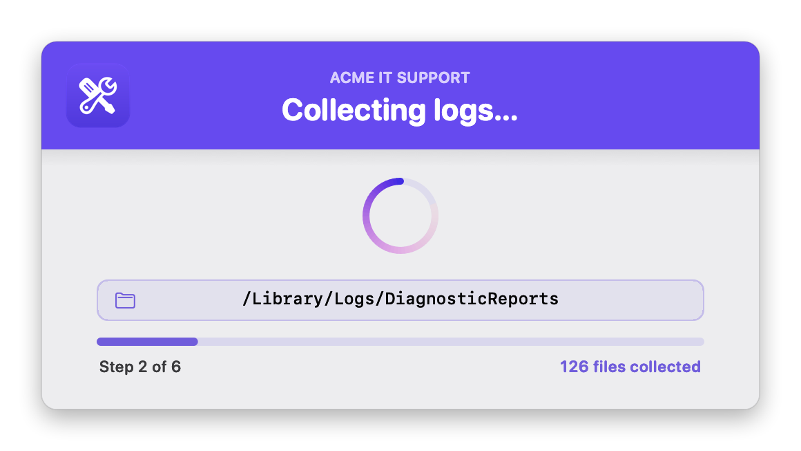
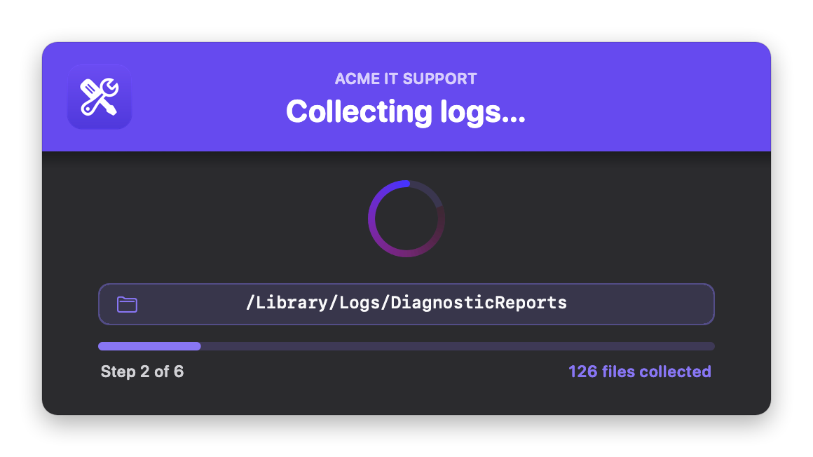
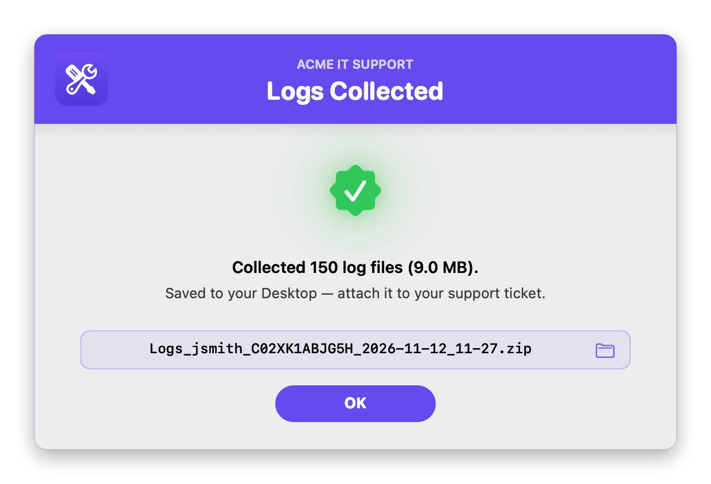
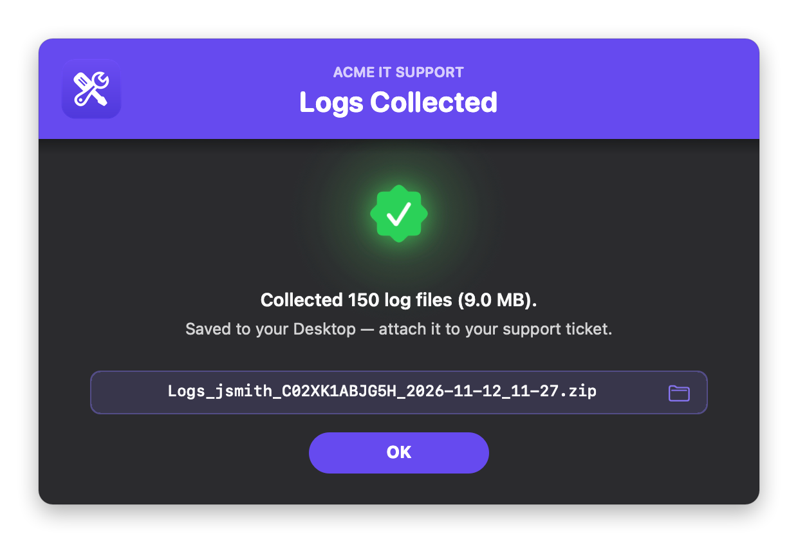

# Collect User Logs

Gathers the logs and system details IT needs from a Mac, zips them into a single archive, and drops it on the logged-in user's Desktop, ready to attach to a support ticket. The user clicks it in **Jamf Self Service**, watches a live progress window, and gets a result screen with the file name. Clicking the file name shows the zip in Finder.

It's fully native, with **no swiftDialog, JamfHelper or other dependencies**. The interface is built with `osascript` (JXA) and AppKit and shows in the logged-in user's session, so it works when Jamf runs it as root. It can also run **headless**, with no windows, to collect silently before a remote session.

### Features:
- **Collects everything useful**:
  - Every `*.log` under `/var/log`, `/Library/Logs`, `/Library/Management` and `~/Library/Logs`, plus rotated logs and crash and diagnostic reports. That includes Jamf, App Auto-Patch and Installomator logs.
  - Logs from **sandboxed apps** such as Teams, Outlook, OneDrive and 1Password, which keep them in `~/Library/Containers` and `~/Library/Group Containers`.
- **Readable reports**: device information, install history, installed apps, background items and configuration profiles, as plain-text files at the top of the zip.
- **Branding**: your logo, brand name and colors. The colors can come **automatically from your logo**, including your Jamf Self Service branding image.
- **Light and dark mode**: follows the user's setting, or you can force one.
- **Fast**: app logs and device information are gathered in the background while the log folders are copied. A typical run takes about 3 seconds.
- **Safe naming**: `Logs_<user>_<serial>_<date>_<time>.zip`. If a zip with that name already exists, `_2`, `_3` and so on is added instead of overwriting it.

## Screens

Shown with the sample logo ([`images/sample_logo.png`](images/sample_logo.png), a generic placeholder you can use for testing) and the brand name "Acme IT Support". Light mode is on the left, dark mode on the right.

**Progress window**: the folder being scanned, a progress bar, the step, and a live file count.
 
 

**Result window**: click the file name to show the zip in Finder.
 
 

## Available Scripts

### 1. [Collect User Logs](https://github.com/cocopuff2u/MacOS_Admin_Scripts/blob/main/Collect_User_Logs/Collect_User_Logs.sh)
- **Description**: Collects logs and system details into a zip on the user's Desktop. Deploy it as a Self Service policy, or run it silently.

## Jamf Setup

1. Go to **Settings > Computer Management > Scripts > New** and paste in the script.
2. In the **Options** tab, set the Parameter Labels:
   - **Parameter 4:** `Action Mode (verbose or silent)`
   - **Parameter 5:** `Extra Log Folders (comma-separated, optional)`
   - **Parameter 6:** `Brand Icon (path, .app, URL, base64, sf:symbol, or selfservice — optional)`
   - **Parameter 7:** `Banner Color (hex, optional)`
   - **Parameter 8:** `Brand Name (optional)`
   - **Parameter 9:** `Appearance (auto, light, or dark)`
3. Add the script to a **Policy** and fill in the parameters. Every one is optional; with all of them blank, you get the default blue look shown in light or dark to match the user.
   - **Parameter 4**: blank or `verbose` shows the progress and result windows. `silent` collects with no windows.
   - **Parameter 5**: extra folders to include, comma-separated, e.g. `/Library/Application Support/MyApp/Logs,/opt/app/log`.
   - **Parameter 6**: your logo. See [Branding](#branding). `selfservice` uses your Jamf Self Service branding image.
   - **Parameter 7**: a hex color like `#1F2937`, or `auto` (match the logo) or `auto-dark` (a deeper shade of the logo color, for white text).
   - **Parameter 8**: a small uppercase line above the title, e.g. `Acme IT Support`.
   - **Parameter 9**: `auto` follows the user's Light/Dark setting; `light` or `dark` forces one.
4. For the user-driven version, set the trigger to **Self Service**. A user must be logged in, because the windows appear in their session. For headless collection, use any trigger with Parameter 4 set to `silent`.

## What's in the zip

Every collected file keeps its original path inside the zip, so IT can see where it came from. These files sit at the top:

| File | Contents |
|---|---|
| `_DEVICE_INFO.txt` | **Device** (user, computer name, serial, model, macOS, uptime) · **Health** (free disk space, memory, last boot, battery cycles and condition) · **Security & management** (FileVault, SIP, Gatekeeper, firewall, MDM enrollment and server, Jamf version) · **Network** (local and public IP, Wi-Fi network and signal, DNS, proxy) · a list of every collected file |
| `_INSTALL_HISTORY.txt` | Every app and macOS install with its date, newest first. The raw `InstallHistory.plist` is included too. |
| `_INSTALLED_APPS.txt` | Name, version, source (App Store, Developer ID, Apple) and path. Built-in macOS apps are left out. |
| `_BACKGROUND_ITEMS.txt` | Launch daemons and agents and what they run, system extensions, and login and background items (`sfltool dumpbtm`, root only) |
| `_PROFILES.txt` | MDM enrollment and configuration profiles. Full detail needs root. |

The public IP comes from `api.ipify.org`, with `checkip.amazonaws.com` as a fallback and a 5-second timeout. Set `LOOKUP_PUBLIC_IP=false` to skip it.

## Branding

Set `BRAND_ICON` (or Parameter 6) to any **one** of these:

| Value | Example | Notes |
|---|---|---|
| Image file | `/Library/Application Support/Acme/logo.png` | png, jpg, heic, icns, pdf, tiff, gif |
| App or folder | `/Applications/Self Service.app` | Uses its Finder icon |
| URL | `https://acme.com/logo.png` | Downloaded each run |
| Base64 | `iVBORw0KGgo…` | Make it with `base64 -i logo.png \| pbcopy`. A `data:image/png;base64,` prefix is fine. Over about 1 MB is too long for a Jamf parameter: paste it into the script, or shrink it first with `sips -Z 256 logo.png`. |
| SF Symbol | `sf:building.2.fill` | Tinted to match the theme |
| Self Service | `selfservice` (or `ss`) | Your Jamf Self Service branding logo, as saved on the Mac for the logged-in user. If they haven't opened Self Service yet, it falls back to the Self Service app's icon, found from the app path Jamf has on record, so renamed apps work. |

If the logo is missing or can't be read, a warning goes in the log and the windows show without it.

### Colors: automatic or forced

Every color setting accepts `"auto"` (the default) or a hex value (`#RRGGBB` or `#RGB`) to force it. An invalid hex value is treated as `auto`.

| Setting | `auto` behavior |
|---|---|
| `bannerColor` | The logo's exact main color. The banner and OK button are drawn from the logo's own pixels, so they match it exactly on screen. `auto-dark` uses a deeper shade instead, so white text reads (4.5:1 contrast). With no logo, the default is `#0056D2`. |
| `BANNER_TEXT_COLOR` | White, or near-black if the banner is too light for white to read |
| `ACCENT_COLOR` | The banner color, lightened in dark mode or darkened in light mode so it stays readable. Used for the spinner, progress bar, file count, chips and folder icons. |
| `SPINNER_BG_COLOR`, `SUCCESS_COLOR`, `FAIL_COLOR` | Apple-style light and dark values |

**How `auto` picks a color from the logo:** it samples the image, ignores transparent, gray and very dark pixels, groups the rest into color families, and takes the most common exact color in the biggest group. For a logo with several colors of about equal size, like Slack or Chrome, the color covering slightly more area wins. Set the hex directly if you want a specific one. The chosen color is logged as `Banner colour from logo: #…`.

## Configuration

All settings are at the top of the script.

| Setting | Default | What it does |
|---|---|---|
| `HEADLESS` | `false` | `true` always runs silently, whatever Parameter 4 says |
| `LOG_SOURCES` | `/var/log`, `/Library/Logs`, `/Library/Management`, `~/Library/Logs` | Folders searched for logs, including subfolders |
| `INCLUDE_ROTATED` | `true` | Also grab rotated and compressed logs (`install.log.0.gz` …) |
| `INCLUDE_CRASH_REPORTS` | `true` | Also grab `.ips`, `.crash`, `.panic`, `.diag` and `.spin` reports |
| `MAX_FILE_MB` | `50` | Skip any single file larger than this (`0` = no limit) |
| `INCLUDE_APP_LOGS` | `true` | Sandboxed app logs (Containers and Group Containers) |
| `INCLUDE_REPORTS` | `true` | Install history, installed apps, background items and profiles reports |
| `LOOKUP_PUBLIC_IP` | `true` | Add the public IP to `_DEVICE_INFO.txt` |
| `ZIP_NAME_PATTERN` | `Logs_{USER}_{SERIAL}_{STAMP}.zip` | Zip file name |
| `STAMP_FORMAT` | `%Y-%m-%d_%H-%M` | Date format for `{STAMP}`, e.g. `2026-11-12_10-40` |
| `logFile` | `/var/log/collect_user_logs.log` | The script's own run log |
| `BRAND_ICON`, `BRAND_NAME` | blank | Logo and brand name (Parameters 6 and 8) |
| `APPEARANCE` | `auto` | `auto`, `light` or `dark` (Parameter 9) |
| Colors | `auto` | See [Colors](#colors-automatic-or-forced) |
| `SPINNER_TEXT`, `RESULT_TITLE`, `RESULT_FAIL_TITLE`, `okButton` | | Window text |

## Notes

- **Run as root for everything.** Run locally as a normal user, some protected logs in `/var/log`, the full login and background item list and computer-level profile details are skipped, and the report files say what's missing. Jamf runs it as root.
- **Requirements:** macOS 11 or later, and macOS 12 or later for the two-color status icons (11 falls back to single-color). Uses only built-in tools: `find`, `ditto`, `osascript`, `system_profiler`, `curl`.
