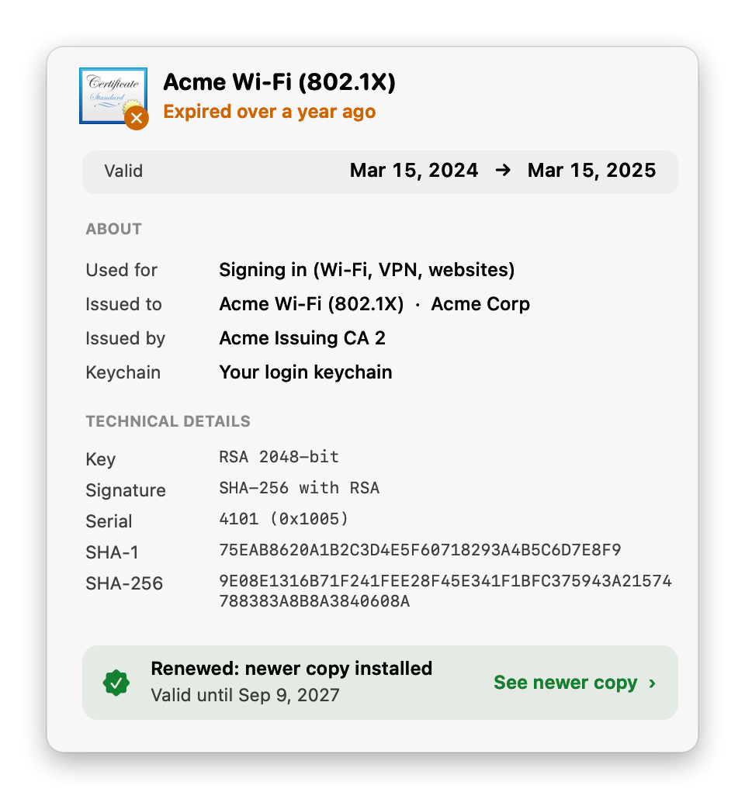
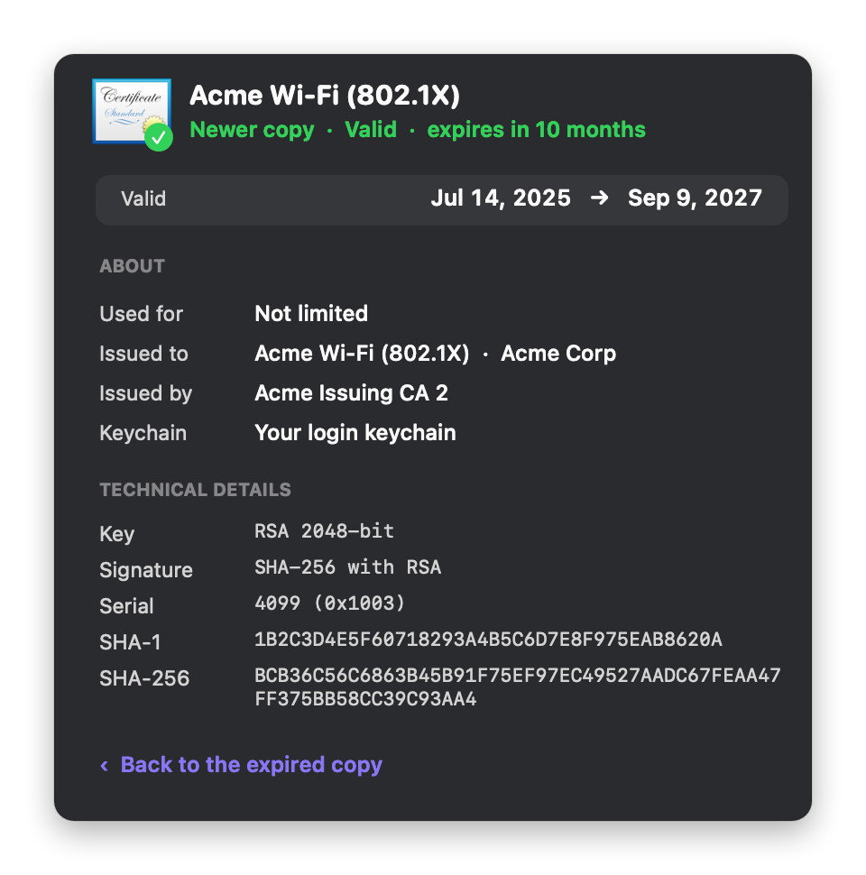
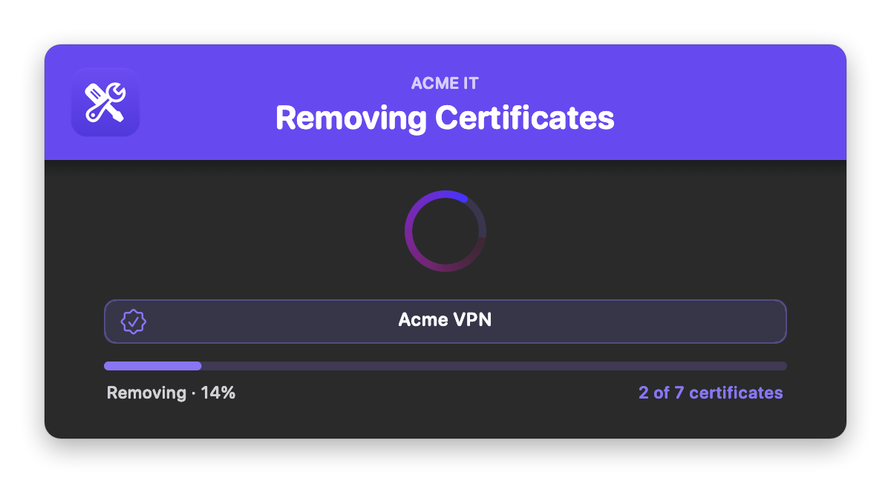

# Delete Expired Certificates

Finds certificates that have already expired in the user's **login keychain** and the **System keychain**, backs each one up, and removes it. Expired certificates can't be used for anything, but they pile up over the years and can cause confusing sign-in, Wi-Fi, VPN and "certificate not trusted" prompts.

The user sees every expired certificate before anything is removed. Or you can run it silently at check-in. It's fully native: the windows are built with `osascript` (JXA) and AppKit, so there's **no swiftDialog or JamfHelper**, and it works when Jamf runs it as root.

### Features:
- **Clear review**: expired certificates are listed under "Your login keychain" and "System keychain", each with the same certificate icon Keychain Access shows (root, personal or standard, with the red ✕ for expired), its name, who issued it, how long ago it expired and the date. The user unchecks anything to keep. Click a keychain's header to hide or show its certificates.
- **Details on click**: click a certificate for a card with what it's used for (in plain words), who it was issued to and by, its valid dates and keychain, and, for IT, the key, signature, serial number and SHA-1 / SHA-256 fingerprints. Hover a row for a quick summary.
- **Renewed badges**: a certificate that already has a newer, valid copy installed (same subject) gets a green **Renewed** badge, so the user knows it's safe to remove. Click the badge to see the newer copy's details.
- **Exclude list**: anything whose name or issuer matches (default `Apple`) is never removed or shown.
- **Backups first**: every certificate is saved as a `.pem` before it's removed. If the backup fails, it's kept. Each run's backup folder has a `manifest.txt` listing what was removed and the commands to put a certificate back.
- **Only certificates**: private keys are never removed.
- **Progress and summary**: a progress window while certificates are removed, then a summary. With nothing expired, the user gets a short "you're all set" window.
- **Branding**: your logo, team name and colors, in light and dark mode.
- **Three modes**: `verbose` (review and confirm), `dry` (the same windows, nothing removed), and `silent` (no windows).

## Screens

**Review**, with the user's certificates and the shared System keychain:
<br />
 

**Details**: click a certificate (left), or its Renewed badge to see the newer copy (right):
<br />
 

**Removing:**
<br />
 

**Done**, and what the user sees when nothing has expired:
<br />
 

## Available Scripts

### 1. [Delete Expired Certificates](https://github.com/cocopuff2u/MacOS_Admin_Scripts/blob/main/Delete_Expired_Certificates/Delete_Expired_Certificates.sh)
- **No dependencies**: uses only built-in macOS tools (`security`, `openssl`, `osascript`).

## Jamf Setup

On the script's **Options** tab in Jamf Pro, add these parameter labels:

| Parameter | Label | Value |
|---|---|---|
| 4 | Action Mode (verbose, dry, or silent) | `verbose` (default): the user reviews and confirms. `dry`: the same windows, nothing removed. `silent`: no windows, removes every expired certificate that isn't excluded. |
| 5 | Exclude Patterns (comma-separated) | Names or issuers to never remove, e.g. `Apple, JSS Built-In, Acme Root CA`. Blank = `EXCLUDE_PATTERNS` (`Apple`). Setting this **replaces** the default, so include `Apple` if you still want it. |
| 6 | Brand Icon (optional) | See [Branding](#branding) |
| 7 | Banner Color (hex, optional) | e.g. `#1F2937`, `auto`, or `auto-dark` |
| 8 | Brand Name (optional) | e.g. `Acme IT` |
| 9 | Appearance (auto, light, or dark) | `auto` follows the user's setting |

Example policies:

| Policy | Parameter 4 | Frequency |
|---|---|---|
| "Remove Expired Certificates" in Self Service | *(blank)* | Ongoing |
| Test a new policy | `dry` | Ongoing |
| Clean up quietly at check-in | `silent` | Once a month |

**Upgrading from 1.x:** Parameter 6 used to be "Dry Run". A policy that still has `dry` there keeps working as a dry run, but update the labels when you can.

## Silent mode

With Parameter 4 set to `silent` (or `HEADLESS=true`), there are no windows. Every expired certificate that isn't excluded is backed up and removed, and each one is listed in the policy log.

In verbose mode with no one logged in, the script removes nothing and exits, since there's no one to confirm. Use `silent` for unattended cleanup.

## Backups

Every certificate is copied to `/var/log/expired-cert-backups/<date-time>/` before it's removed. The folder can only be read by root. Each run's `manifest.txt` lists every certificate it removed (keychain, expiry, SHA-1, full subject) and how to put one back:

```bash
# login keychain (as the user)
sudo -u jsmith security add-certificates -k /Users/jsmith/Library/Keychains/login.keychain-db <file>.pem
# System keychain
sudo security add-certificates -k /Library/Keychains/System.keychain <file>.pem
```

Trust settings aren't restored, so re-trust the certificate in Keychain Access if it needs it.

## Branding

Set the logo with Parameter 6 or `BRAND_ICON`:

| Value | Example | Notes |
|---|---|---|
| Image file | `/Library/Application Support/Acme/logo.png` | png, jpg, heic, icns, pdf, tiff, gif |
| App or folder | `/Applications/Self Service.app` | Uses its Finder icon |
| URL | `https://acme.com/logo.png` | Downloaded each run |
| Base64 | `iVBORw0KGgo…` | Make it with `base64 -i logo.png \| pbcopy` |
| SF Symbol | `sf:checkmark.seal.fill` | Tinted to match the theme |
| Self Service | `selfservice` (or `ss`) | Your Jamf Self Service branding logo, falling back to the Self Service app's icon |

### Colors

Each color setting takes a hex value or `auto`:

| Setting | `auto` behavior |
|---|---|
| `bannerColor` | The logo's exact main color. `auto-dark` uses a deeper shade so white text reads. With no logo, `#0056D2`. |
| `BANNER_TEXT_COLOR` | White, or near-black if the banner is too light for white to read |
| `ACCENT_COLOR` | The banner color, made readable on the window. Used for checkboxes, the spinner, progress bar and buttons. |
| `SPINNER_BG_COLOR`, `SUCCESS_COLOR`, `FAIL_COLOR` | Apple-style light and dark values |

## Configuration

At the top of the script:

| Setting | Default | What it does |
|---|---|---|
| `HEADLESS` | `false` | `true` always runs silently, whatever Parameter 4 says |
| `DRY_RUN_OVERRIDE` | `false` | `true` always previews. Keep `false` for production |
| `SCAN_SYSTEM_KEYCHAIN` | `true` | Also check the System keychain (changing it needs root) |
| `EXCLUDE_PATTERNS` | `("Apple")` | Names or issuers to never remove (Parameter 5 replaces it) |
| `BACKUP_PARENT` | `/var/log/expired-cert-backups` | Where backups go |
| `logFile` | `/var/log/delete_expired_certificates.log` | The script's own run log |
| `BRAND_ICON` | blank | Logo (Parameter 6) |
| `BRAND_NAME` | `IT Support` | Small line above the title, e.g. `Acme IT` (Parameter 8). Blank = none |
| `APPEARANCE` | `auto` | `auto`, `light` or `dark` (Parameter 9) |
| Colors | `auto` | See [Colors](#colors) |
| `REVIEW_TITLE`, `REVIEW_NOTE`, `DONE_TITLE`, button labels… | | Window text. `removeButton` uses `{N}` for the count |

## Testing

```bash
./Delete_Expired_Certificates.sh dry                       # review window, nothing removed
./Delete_Expired_Certificates.sh dry "" "sf:checkmark.seal.fill" "#1F6FEB" "Acme IT" dark
sudo ./Delete_Expired_Certificates.sh                      # the real thing, as Jamf runs it
```

Without `sudo`, only the login keychain can be changed. The System keychain is skipped (it's still listed in a dry run), and backups go to `~/Library/Logs/expired-cert-backups`.

## Notes

- Requires macOS 12 or later.
- Exit codes: `0` = removed, dry run, cancelled or nothing to do. `1` = one or more certificates couldn't be backed up or removed (Jamf marks the policy as failed).
- "Renewed" means a valid certificate with exactly the same subject is installed in either keychain.
- The certificate icons are the ones macOS ships for Keychain Access (`SecurityInterface.framework`): gold = root (self-signed), grey = personal (has a private key), blue = everything else.
