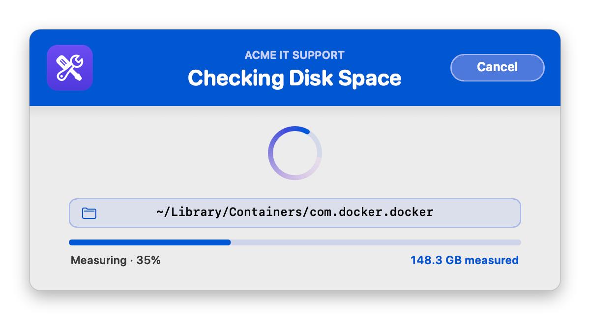
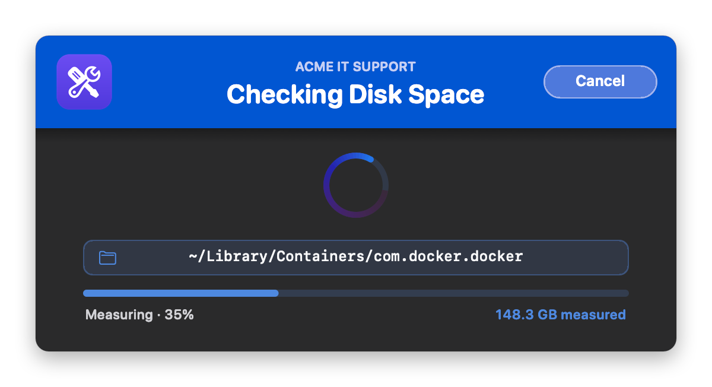
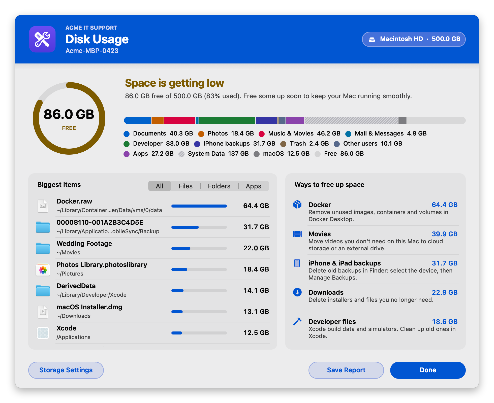
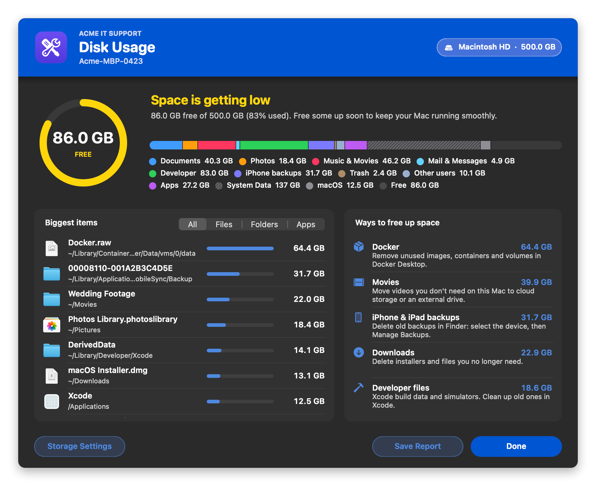
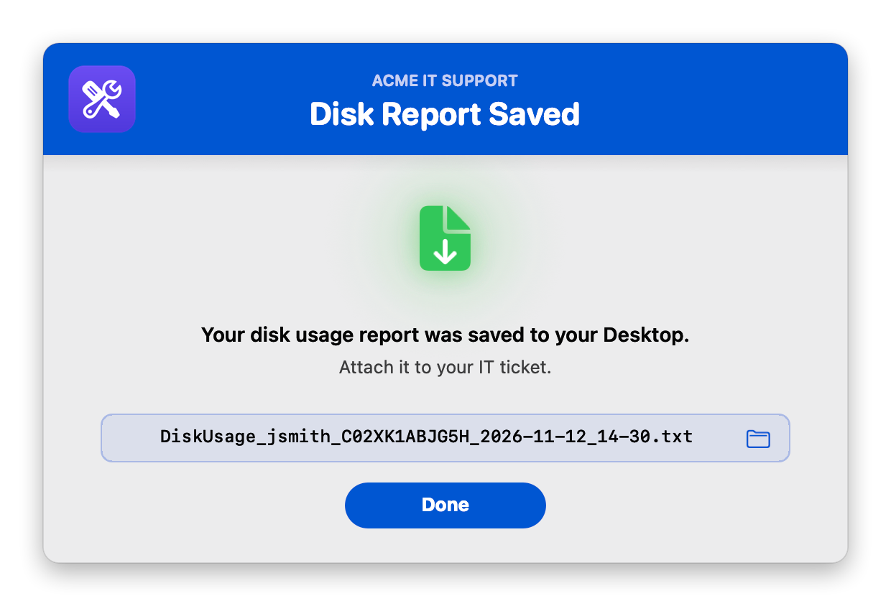
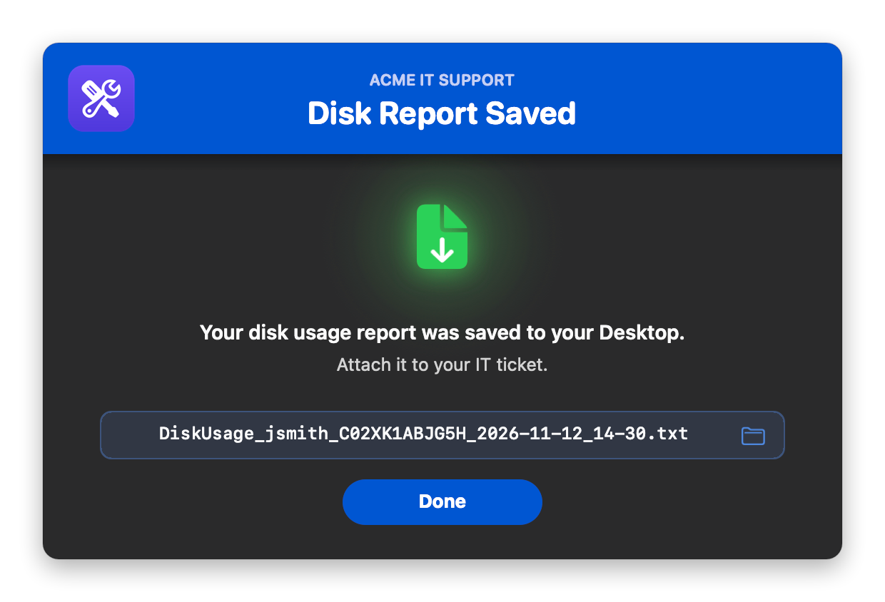

# Disk Usage

Shows the user, and IT, what is filling up the Mac's disk. The user clicks it in **Jamf Self Service** and watches a live progress window while the whole disk is measured in one pass. A results window then shows:

- how full the disk is
- what the space is used by
- the biggest items, where one click shows the item in Finder
- simple ways to free up space

One click saves a full text report to the Desktop for the support ticket.

It's fully native, with **no swiftDialog, JamfHelper or other dependencies**. The interface is built with `osascript` (JXA) and AppKit and shows in the logged-in user's session, so it works when Jamf runs it as root. It can also run **headless** and print the report to the policy log. It was inspired by Dan Snelson's [Disk Usage with swiftDialog](https://snelson.us/2022/11/disk-usage-with-swiftdialog-0-0-2/).

### Features:
- **One pass over the whole disk**: the data volume is measured once, with live progress (the folder being measured, a progress bar, the percent and the amount measured). **Cancel** or Esc stops it right away.
- **How full the disk is**: a ring with the free space inside. It turns yellow or red when space runs low, with a headline that says so in plain words.
- **What's using space**: one bar split into categories like System Settings > Storage. Your stuff (Documents, Photos, Music & Movies, Mail & Messages, Developer, iPhone backups, Trash, Other users) each has its own color. Apps are purple, and the system parts are gray: System Data is striped and macOS is solid. The legend puts your stuff on its own row, so personal and system space are easy to tell apart.
- **Biggest items, not just big folders**: it follows the space down to where it actually sits. Instead of "~/Library 80 GB" it shows `Docker.raw`, an iPhone backup, or a Downloads folder full of installers. Each row has its Finder icon; click it to show the item in Finder.
- **All · Files · Folders · Apps tabs**: All mixes everything by size; the other tabs show just the largest single files (old installers, videos, disk images), the largest folders, or the largest apps. Each tab holds up to 30 items and scrolls.
- **Ways to free up space**: Trash, Downloads, iPhone and iPad backups, Movies, Docker, Xcode, app caches, Mail, and local Time Machine snapshots. Each shows its size and what to do about it. Tips only appear when they would free a useful amount.
- **Storage Settings** button: opens System Settings > Storage (Storage Management on macOS 12).
- **Full report**: what's using space, biggest items, home folder breakdown, the 50 largest folders, the 25 largest apps, the 25 largest files, and Time Machine snapshots. It's saved as `DiskUsage_<user>_<serial>_<date>_<time>.txt`. If that name exists, `_2`, `_3` and so on is added.
- **Branding**: your logo, brand name and colors. The colors can come **automatically from your logo**, including your Jamf Self Service branding image.
- **Light and dark mode**: follows the user's setting, or you can force one.

## Screens

Shown with the sample logo ([`images/sample_logo.png`](images/sample_logo.png), a generic placeholder you can use for testing), the brand name "Acme IT Support", and sample data. Light mode is on the left, dark mode on the right.

**Progress window**: the folder being measured, a progress bar, and the amount measured so far.
<br />
 

**Results window**: click any item to show it in Finder.
<br />
 

**Report saved**: click the file name to show the report in Finder.
<br />
 

## Available Scripts

### 1. [Disk Usage](https://github.com/cocopuff2u/MacOS_Admin_Scripts/blob/main/Disk_Usage/Disk_Usage.sh)
- **Description**: Shows what's using the Mac's disk space and how to free some up. Deploy it as a Self Service policy, or run it silently for a report in the policy log.

## Jamf Setup

1. Go to **Settings > Computer Management > Scripts > New** and paste in the script.
2. In the **Options** tab, set the Parameter Labels:
   - **Parameter 4:** `Action Mode (verbose or silent)`
   - **Parameter 5:** `Brand Icon (path, .app, URL, base64, sf:symbol, or selfservice — optional)`
   - **Parameter 6:** `Banner Color (hex, optional)`
   - **Parameter 7:** `Brand Name (optional)`
   - **Parameter 8:** `Appearance (auto, light, or dark)`
3. Add the script to a **Policy** and fill in the parameters. Every one is optional; with all of them blank, you get the default blue look shown in light or dark to match the user.
   - **Parameter 4**: blank or `verbose` shows the progress and results windows. `silent` shows no windows and prints the full report to the policy log.
   - **Parameter 5**: your logo. See [Branding](#branding). `selfservice` uses your Jamf Self Service branding image.
   - **Parameter 6**: a hex color like `#1F2937`, or `auto` (match the logo) or `auto-dark` (a deeper shade of the logo color, for white text).
   - **Parameter 7**: a small uppercase line above the title, e.g. `Acme IT`. Blank = `BRAND_NAME` in the script (`IT Support`).
   - **Parameter 8**: `auto` follows the user's Light/Dark setting; `light` or `dark` forces one.
4. For the user-driven version, set the trigger to **Self Service**. For a report without bothering the user, use any trigger with Parameter 4 set to `silent`; the report appears in the policy log. If nobody is logged in, it runs silently automatically.

## When it warns

The ring and headline change color when free space drops below **either** limit:

| Status | Default | Setting |
|---|---|---|
| 🟢 Plenty of free space | 20% free or more, and at least 30 GB | |
| 🟡 Space is getting low | under 20% free, or under 30 GB | `WARN_FREE_PERCENT`, `WARN_FREE_GB` |
| 🔴 Almost out of space | under 10% free, or under 15 GB | `CRIT_FREE_PERCENT`, `CRIT_FREE_GB` |

Free and total space are for the whole disk, as System Settings > Storage shows them.

## How it works

- It measures the **data volume**, which is where everything except macOS itself lives, with `du -x`, so it never wanders onto other disks or network shares. The big folders (the home folder, `~/Library` and its Containers and Application Support, `/Library`, `/private`, `/Applications`) are opened up and each thing inside is measured on its own. That keeps the progress bar moving steadily.
- **Packages count as one item**: an app, a Photos library or a virtual machine shows as one item, and the scan doesn't list the files inside it.
- **Biggest items**: an item is listed when no single thing inside it makes up half of it. That's how the scan drills past `~/Library` → `Containers` → `com.docker.docker`… down to the actual `Docker.raw`. Items never overlap, so the same space isn't listed twice. The window lists items in the home folder, apps and users' folders, which the user can act on. The saved report also lists macOS and system items for IT.
- **Categories**: Photos is `~/Pictures`; Music & Movies is `~/Music` and `~/Movies`; Mail & Messages is `~/Library/Mail` and `Messages`; Developer is `~/Library/Developer` plus Docker; iPhone backups is `MobileSync`; Documents is the rest of your home folder outside `~/Library`, plus iCloud Drive. **macOS** is the sealed system volume. **System Data** is everything else: caches and app data in `~/Library`, `/Library`, `/private`, other volumes and, when not run as root, anything it wasn't allowed to measure. Slivers too small to see are folded into Documents or System Data.
- A typical scan takes 15 to 40 seconds, depending on how many files the Mac has.

## Branding

Set `BRAND_ICON` (or Parameter 5) to any **one** of these:

| Value | Example | Notes |
|---|---|---|
| Image file | `/Library/Application Support/Acme/logo.png` | png, jpg, heic, icns, pdf, tiff, gif |
| App or folder | `/Applications/Self Service.app` | Uses its Finder icon |
| URL | `https://acme.com/logo.png` | Downloaded each run |
| Base64 | `iVBORw0KGgo…` | Make it with `base64 -i logo.png \| pbcopy`. Over about 1 MB is too long for a Jamf parameter: paste it into the script, or shrink it first with `sips -Z 256 logo.png`. |
| SF Symbol | `sf:internaldrive.fill` | Tinted to match the theme |
| Self Service | `selfservice` (or `ss`) | Your Jamf Self Service branding logo, as saved on the Mac for the logged-in user. If they haven't opened Self Service yet, it falls back to the Self Service app's icon. |

If the logo is missing or can't be read, a warning goes in the log and the windows show without it.

### Colors

Every color setting accepts `"auto"` (the default) or a hex value (`#RRGGBB` or `#RGB`) to force it. An invalid hex value is treated as `auto`. They work the same way as in [Collect User Logs](https://github.com/cocopuff2u/MacOS_Admin_Scripts/blob/main/Collect_User_Logs#colors-automatic-or-forced):

| Setting | `auto` behavior |
|---|---|
| `bannerColor` | The logo's exact main color. `auto-dark` uses a deeper shade so white text reads. With no logo, `#0056D2`. |
| `BANNER_TEXT_COLOR` | White, or near-black if the banner is too light for white to read |
| `ACCENT_COLOR` | The banner color, made readable on the window. Used for the spinner, progress bar, size bars, tip icons and buttons. |
| `SPINNER_BG_COLOR`, `SUCCESS_COLOR`, `FAIL_COLOR` | Apple-style light and dark values |

## Configuration

All settings are at the top of the script.

| Setting | Default | What it does |
|---|---|---|
| `HEADLESS` | `false` | `true` always runs silently, whatever Parameter 4 says |
| `BIG_ITEMS_SHOWN` | `7` | Rows visible at once in the Biggest items list (it scrolls for more) |
| `BIG_ITEMS_MAX` | `30` | Items each tab (All, Files, Folders, Apps) holds (the report lists 25) |
| `SIMULATE` | `off` | `low`, `full` or `ok` shows made-up sample data instead of scanning. See [Demo mode](#demo-mode) |
| `TIPS_SHOWN` | `5` | Most "Ways to free up space" rows in the window |
| `MIN_ITEM_MB` | `100` | Items smaller than this are never listed |
| `TIP_MIN_MB` | `500` | A tip only shows when it would free at least this much |
| `WARN_FREE_PERCENT`, `WARN_FREE_GB` | `20`, `30` | Yellow below either |
| `CRIT_FREE_PERCENT`, `CRIT_FREE_GB` | `10`, `15` | Red below either |
| `REPORT_NAME_PATTERN` | `DiskUsage_{USER}_{SERIAL}_{STAMP}.txt` | Saved report name |
| `STAMP_FORMAT` | `%Y-%m-%d_%H-%M` | Date format for `{STAMP}`, e.g. `2026-11-12_14-30` |
| `logFile` | `/var/log/disk_usage.log` | The script's own run log |
| `BRAND_ICON` | blank | Logo (Parameter 5) |
| `BRAND_NAME` | `IT Support` | Small line above the title, e.g. your team name `Acme IT` (Parameter 7). Blank = none |
| `APPEARANCE` | `auto` | `auto`, `light` or `dark` (Parameter 8) |
| Colors | `auto` | See [Colors](#colors) |
| `SPINNER_TEXT`, `RESULT_TITLE`, `SAVED_TITLE`, button labels | | Window text |

## Testing

```bash
./Disk_Usage.sh                      # windows, as you (some protected folders can't be measured)
sudo ./Disk_Usage.sh                 # windows, as root (measures everything, like Jamf does)
sudo ./Disk_Usage.sh silent          # no windows, report printed to the terminal
./Disk_Usage.sh verbose "sf:internaldrive.fill" "#1F6FEB" "Acme IT Support" dark
./Disk_Usage.sh demo                 # made-up sample data: "Space is getting low"
./Disk_Usage.sh demo-full            # sample data: "Almost out of space"   (demo-ok = plenty free)
```

### Demo mode

`demo`, `demo-full` and `demo-ok` (or `SIMULATE` in the script) skip the scan and use made-up sample data instead. The sample includes a 64 GB `Docker.raw`, an iPhone backup, video folders, disk images, a Photos library, Xcode data, big apps and another user's files, on a 500 GB disk. The data goes through exactly the same analysis as a real scan, so you can see the drill-down, all four tabs, the tips, the colors and the saved report. There's a short pretend scan so you can see the progress window too. Nothing on the Mac is measured or changed. The window and report are marked as a demo, and clicking an item shows the nearest real folder.

## Notes

- **Run as root for the full picture.** Run locally as a normal user, folders protected by macOS privacy controls (and other users' folders) can't be measured, so their space counts toward "macOS & system", and the window says so. Jamf runs it as root. For folders protected by macOS privacy controls, such as Mail and some app containers, give the Jamf binary Full Disk Access with a PPPC profile, as most Jamf setups already do.
- **Nothing is deleted.** The script only measures. It never changes or removes files; the tips tell the user what to do.
- **Requirements:** macOS 11 or later. Uses only built-in tools: `du`, `diskutil`, `tmutil`, `osascript`.
