# Installomator Progress

Installs or updates apps with [Installomator](https://github.com/Installomator/Installomator) and shows the user a small progress window: the app icon, your message, a progress bar, and what's happening right now (Downloading… 42%, Verifying…, Installing…, Done).

It's **one script** that replaces the usual three-script setup, **00 - Prepare SwiftDialog** → Installomator → **ZZ - Quit SwiftDialog**, and it needs **no swiftDialog**. The window is built with `osascript` (JXA) and AppKit and shows in the logged-in user's session, so it works when Jamf runs the script as root. Like [App Auto-Patch](https://github.com/App-Auto-Patch/App-Auto-Patch), it keeps its own local copy of Installomator.

### Features:
- **No swiftDialog**: the window reads the same progress messages Installomator writes for swiftDialog, so you get the same live progress without installing anything.
- **Its own Installomator**: downloads Installomator once, keeps it in `/Library/Management/Installomator`, and only downloads it again when there's a newer version. Choose the **main** branch (default, like App Auto-Patch), the latest signed **release**, or **pin** a version like `10.8`. If GitHub can't be reached, the local copy is used.
- **Signed releases are checked**: a release pkg is only used if Apple accepts it and it's signed by Installomator's Team ID (`JME5BW3F3R`).
- **A bar that shows what's really happening**: it fills with the real download (and pkg install) progress. While Installomator is busy without a percentage (mounting, verifying, copying), the bar dims and a bright segment sweeps across it, so it never looks finished early. Every change is a smooth fade.
- **Four window styles**: mini (default), toast, card and hud, each with its own spot on screen.
- **Your icons**: any app, image, URL, SF Symbol or your Jamf Self Service branding, with an optional small logo on the corner. If an icon can't be loaded, the App Store icon is used.
- **Your bar color**: the user's accent color by default, or your own, with a separate shade for dark mode.
- **Light and dark mode**: follows the user's setting, even if they switch during an install.
- **Several apps in one policy**: list several labels and they install one after another.
- **A clean policy log**: the key steps, Installomator's important lines and one result per app (`Installed 1.2.4`, `Updated 1.1 → 1.2.4`, `Already up to date`, `FAILED (error 1: …)`), then a summary. Installomator's full log is still in `/var/log/Installomator.log`.
- **Failures show in Jamf**: the script exits with Installomator's error code, so a failed install shows as failed.

## Screens

Shown with the sample logo ([`images/sample_logo.png`](images/sample_logo.png), a generic placeholder you can use for testing) and the message "Installing Acme Tools…". Each style is shown **Downloading → Installing → Done**, in light mode and then dark mode. While Installomator is busy without a percentage, the bar dims and a bright segment sweeps across it.

**Mini** (default, bottom right)
<br />
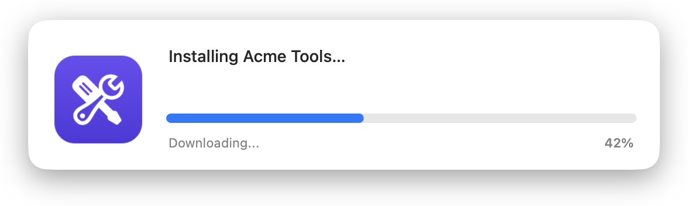 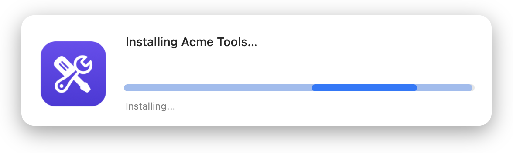 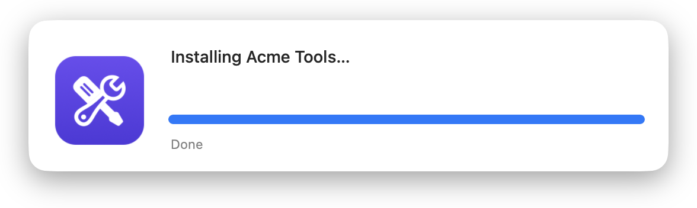
<br />
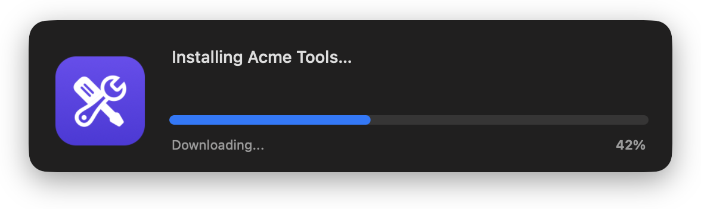 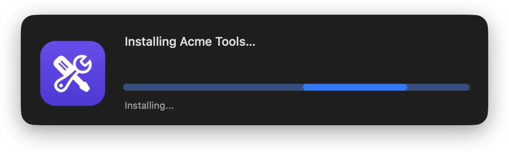 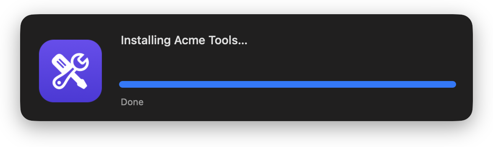

**Toast** (top right)
<br />
 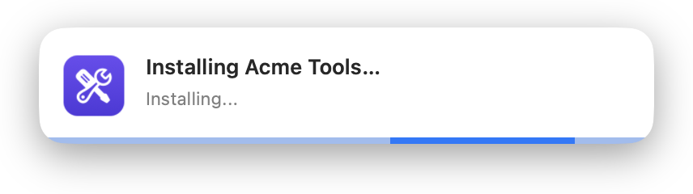 
<br />
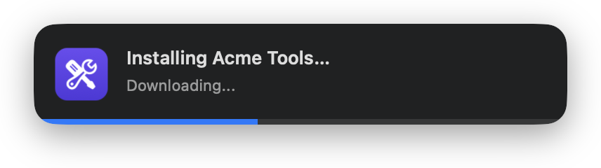 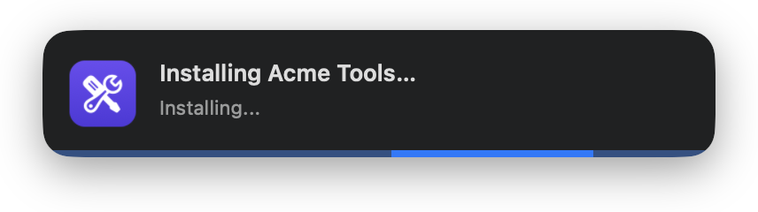 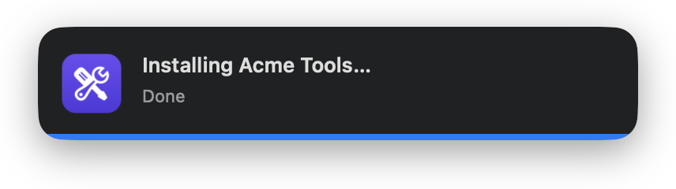

**Card** (center of the screen; it sizes itself to the message)
<br />
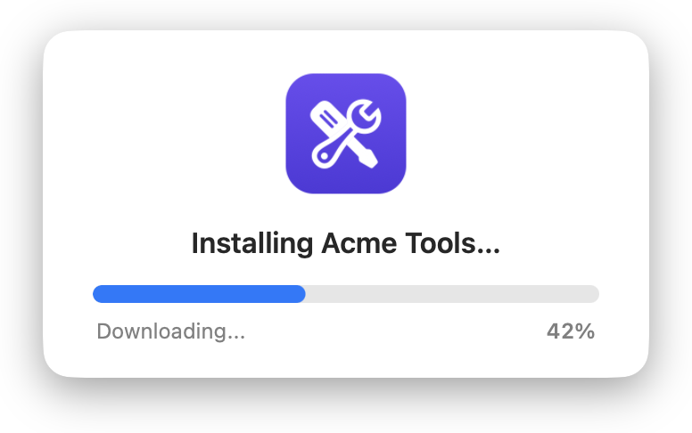 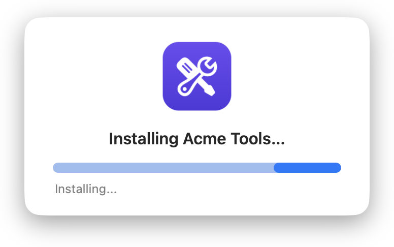 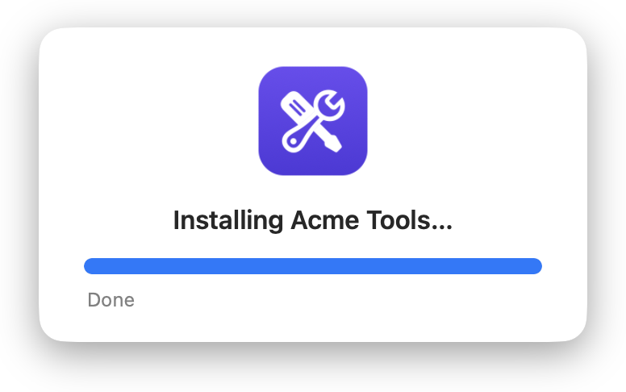
<br />
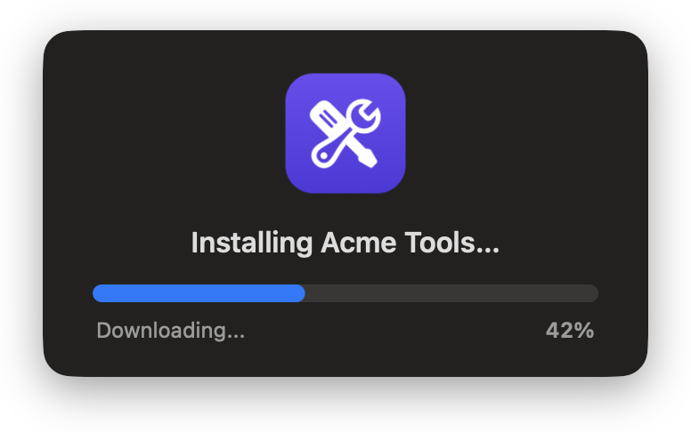 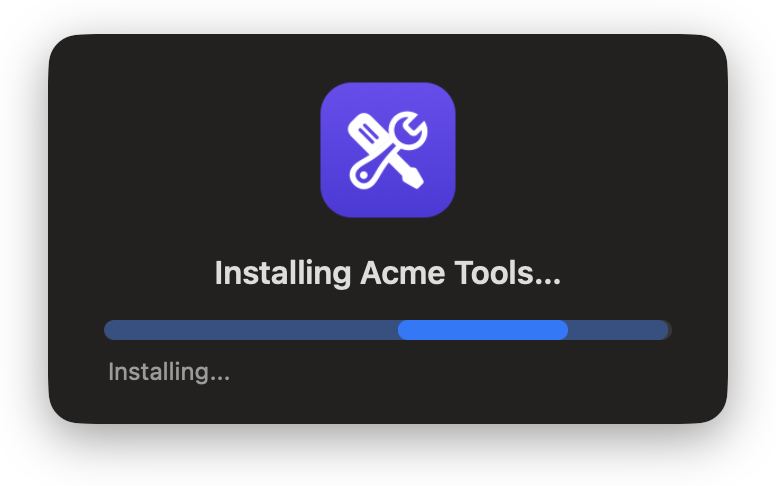 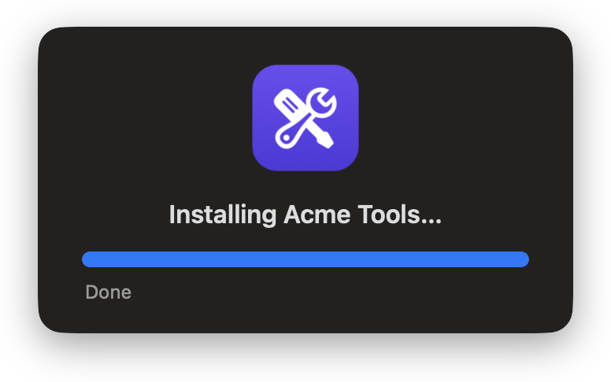

**HUD** (bottom center; a frosted, see-through panel)
<br />
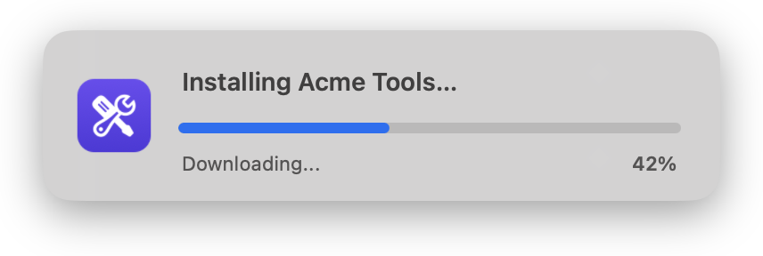 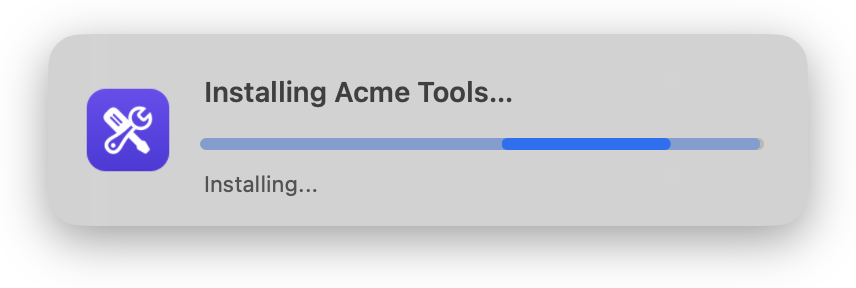 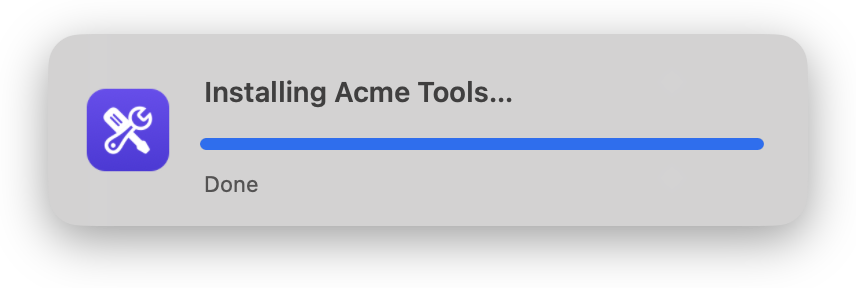
<br />
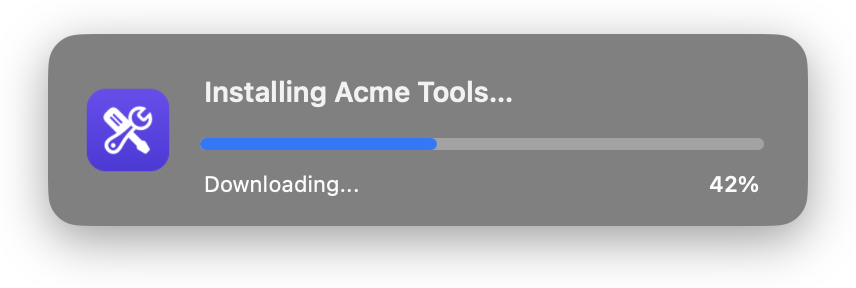 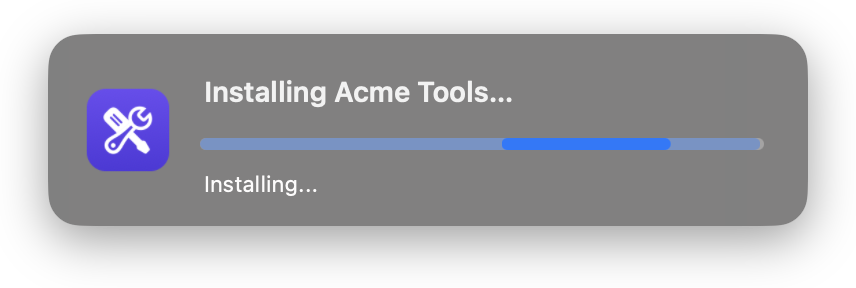 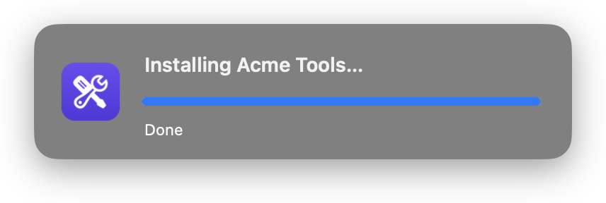

## Available Scripts

### 1. [Installomator Progress](https://github.com/cocopuff2u/MacOS_Admin_Scripts/blob/main/Installomator_Progress/Installomator_Progress.sh)
- **Description**: Installs or updates apps with a local copy of Installomator and shows a native progress window. No swiftDialog needed.

## Jamf Setup

1. Go to **Settings > Computer Management > Scripts > New** and paste in the script.
2. In the **Options** tab, set the Parameter Labels:

| Parameter | Label |
|---|---|
| 4 | `Installomator label(s)` |
| 5 | `Message (text above the progress bar)` |
| 6 | `Icon (path, .app, URL, sf:symbol, or selfservice)` |
| 7 | `Overlay icon (path, .app, URL, sf:symbol, selfservice, or none)` |
| 8 | `Extra Installomator options (optional)` |
| 9 | `Installomator version (main, release, or a version like 10.8)` |
| 10 | `Window style and/or position (mini, toast, card, hud)` |
| 11 | `Show app version in the status text (show or hide)` |

3. Add the script to a **Policy** and fill in the parameters. Only Parameter 4 is required.

| Parameter | Blank = | Examples |
|---|---|---|
| **4** Labels | *required* | `googlechromepkg` · `zoom slack` (several install one after another) |
| **5** Message | `Installing <label>…` | `Installing Google Chrome…` |
| **6** Icon | the App Store icon | `/Applications/Google Chrome.app` · `https://acme.com/chrome.png` · `sf:shippingbox` · `selfservice` |
| **7** Overlay icon | `Dialog.png` if you have one, else your Self Service branding | `selfservice` · `none` · a path or URL |
| **8** Options | `NOTIFY=silent` | `INSTALL=force` · `BLOCKING_PROCESS_ACTION=prompt_user` · `DEBUG=1` |
| **9** Installomator | `main` | `release` · `10.8` |
| **10** Window | `mini`, bottom right | `toast` · `card` · `hud` · `mini topleft` · `card topright` |
| **11** Version | `hide` (`Downloading...`) | `show` (`v1.2.4 Downloading...`) |

`selfservice` uses your Jamf Self Service branding image (Jamf Pro > Self Service > Branding), falling back to the Self Service app's icon. Parameter 8 takes any [Installomator option](https://github.com/Installomator/Installomator/wiki) as `VAR=value`.

Example policies:

| Policy | Parameter 4 | Other parameters |
|---|---|---|
| Install Google Chrome from Self Service | `googlechromepkg` | 5 = `Installing Google Chrome…`, 6 = `/Applications/Google Chrome.app`, 10 = `card` |
| Patch several apps quietly in the corner | `zoom slack microsoftteamsnew` | 10 = `toast` |
| Reinstall an app that's broken | `googlechromepkg` | 8 = `INSTALL=force` |
| Test a label without installing | `googlechromepkg` | 8 = `DEBUG=1` |

## Window styles

Each style has its own spot on screen. Add a position to Parameter 10 to move it, e.g. `mini topleft`.

| Style | Looks like | Default spot |
|---|---|---|
| `mini` (1) | Icon and logo on the left; message, bar, status and % on the right | Bottom right |
| `toast` (2) | Small: icon, message and status, thin bar along the bottom edge | Top right |
| `card` (3) | Centered icon and logo, message, bar, status and % | Center |
| `hud` (4) | Frosted panel: icon and logo, message, bar, status and % | Bottom center |

Positions: `bottomright`, `bottomleft`, `bottomcenter`, `topright`, `topleft`, `topcenter`, `center`.

The **%** shows only while there's real progress to report (1–99%), not on Done, busy steps or failures.

## Installomator version

| Parameter 9 | Uses | Checked by | Updated |
|---|---|---|---|
| `main` (default) | The main branch on GitHub: the newest labels and fixes, including ones not released yet | It must be a complete Installomator script (not signed) | When GitHub's copy changes |
| `release` | The latest release | Apple notarization and Team ID `JME5BW3F3R` | When a newer release comes out |
| `10.8` | That exact release, pinned | Apple notarization and Team ID `JME5BW3F3R` | Never |

The copy is kept in `/Library/Management/Installomator`, with a note of which version it is, so switching between `main`, `release` and a pinned version replaces it. If GitHub can't be reached (or a download fails its checks), the local copy is used and the log says so.

## How it works

1. Gets Installomator ready (see above) and opens the window in the logged-in user's session. If nobody is logged in, it installs without a window.
2. Runs Installomator for each label with `DIALOG_CMD_FILE` set to a temporary file. Installomator writes its progress there (`progress: 42`, `progresstext: Downloading...`), and the window reads it four times a second.
3. Installomator only writes that progress when `/usr/local/bin/dialog` (swiftDialog) exists, so each run uses a temporary copy of Installomator with that one check pointed at `/usr/bin/true`. Your local `Installomator.sh` is never changed.
4. Shows **Done** (or the error), closes the window, deletes the temporary files, and exits with Installomator's result.

## Configuration

At the top of the script:

| Setting | Default | What it does |
|---|---|---|
| `INSTALLOMATOR_VERSION` | `main` | Which Installomator to use (Parameter 9) |
| `INSTALLOMATOR_DIR` | `/Library/Management/Installomator` | Where the local copy is kept |
| `INSTALLOMATOR_TEAM_ID` | `JME5BW3F3R` | The Team ID release pkgs must be signed with |
| `CHECK_FOR_UPDATES` | `true` | `false` = only download when it's missing or you switch version |
| `DEFAULT_OPTIONS` | `NOTIFY=silent` | Always passed to Installomator; Parameter 8 can override it |
| `WINDOW_STYLE` | `mini` | Window style (Parameter 10) |
| `WINDOW_POSITION` | blank | Blank = the style's own spot (Parameter 10) |
| `DEFAULT_ICON` | App Store | Icon when Parameter 6 is blank |
| `SHOW_VERSION` | `false` | Show the app version in the status text (Parameter 11) |
| `BAR_COLOR` | `accent` | `accent` = the user's accent color · `#0056D2` = one color · `#0056D2/#4C9AFF` = light / dark mode |
| `CONSOLE_LOG` | `summary` | `full` = also every line Installomator prints, in the policy log |

## Testing

```bash
# Download and check the app, but never install it (a safe way to watch the window)
sudo ./Installomator_Progress.sh / "" "" googlechromepkg "Installing Google Chrome…" "/Applications/Google Chrome.app" "" "DEBUG=1"

# Reinstall for real, in the card style
sudo ./Installomator_Progress.sh / "" "" googlechromepkg "Installing Google Chrome…" "/Applications/Google Chrome.app" "" "INSTALL=force" "" card
```

The first three arguments stand in for the ones Jamf passes (mount point, computer name, user).

## Notes

- Requires macOS 11 or later, run as root (Jamf runs scripts as root).
- Exit codes: `0` = every label installed or was already up to date. Otherwise Installomator's exit code for the last label that failed. `1` = Installomator couldn't be downloaded and there's no local copy. `95`–`98` = bad Parameter 9, no label, not run as root, macOS too old.
- Installomator decides whether to install by comparing the installed version with the latest one. It only checks that they're the same, not which is newer, so a beta newer than the latest release gets replaced. Add `INSTALL=force` to Parameter 8 to always reinstall.
