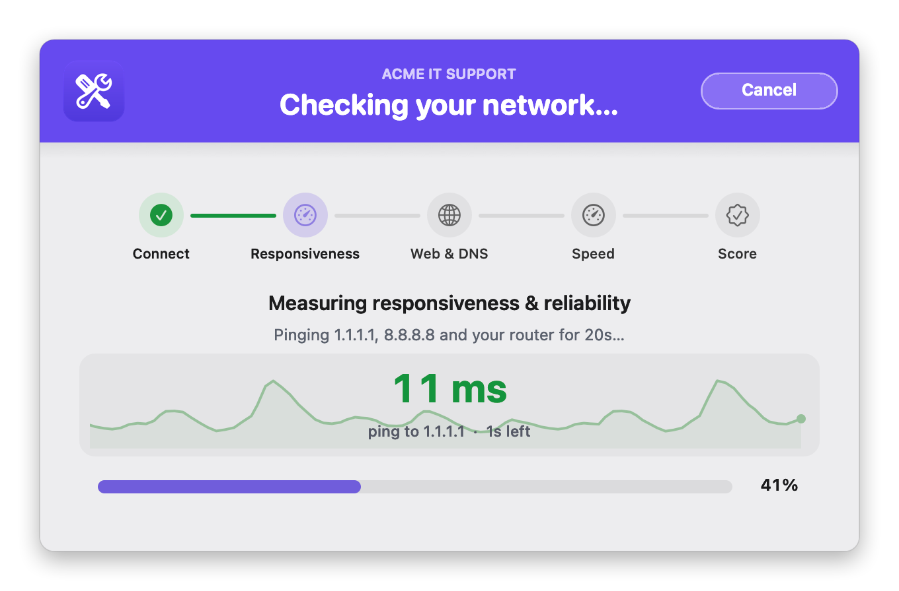
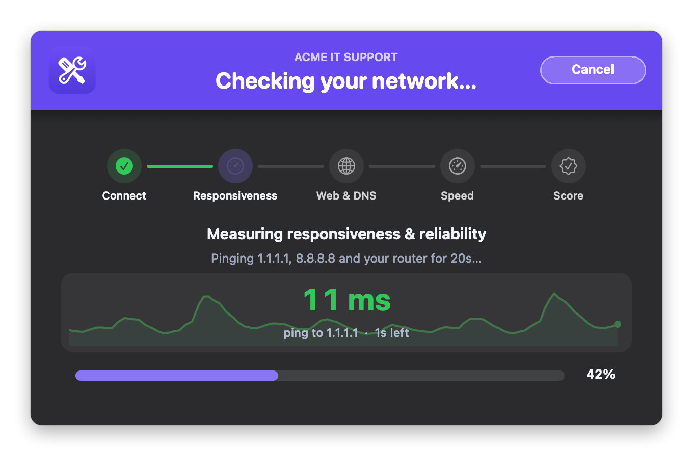
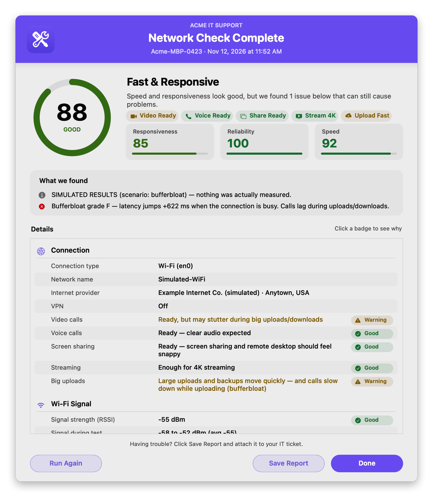
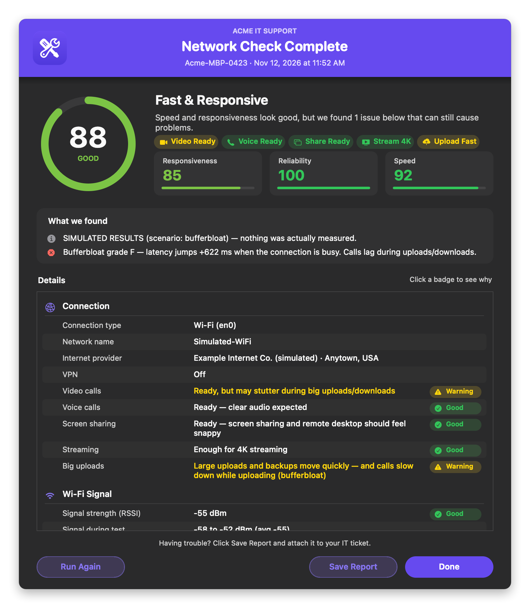
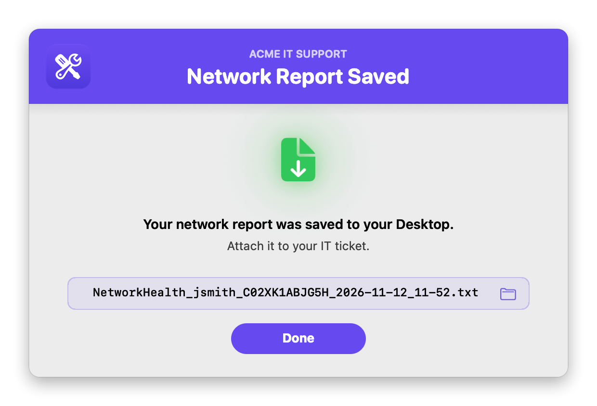
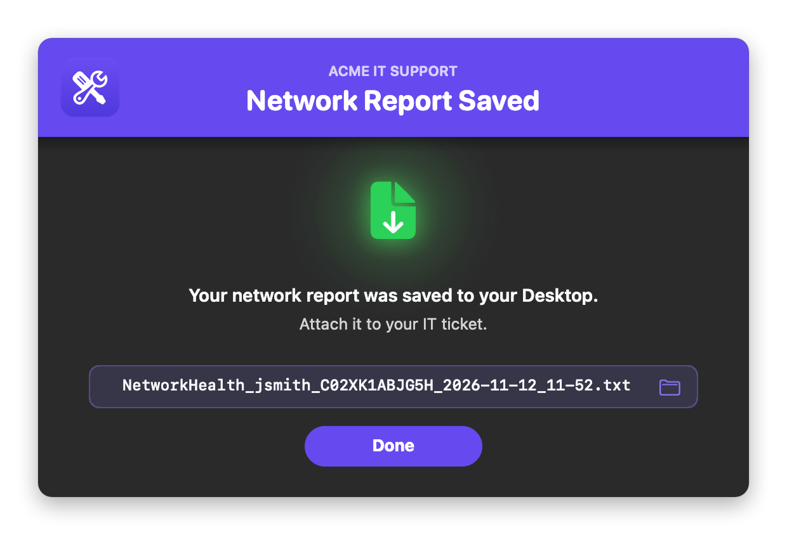

# Network Health Check

Tests the Mac's network connection and shows the user a clear, plain-English results window. The window has a **0–100 Network Score**, verdicts for **what the connection is ready for** (video and voice calls, screen sharing, streaming, big uploads), and findings that say what's wrong. Below that is a **For IT** section with the details needed to troubleshoot. **Save Report** puts a text report on the user's Desktop, ready to attach to a ticket.

It's fully native, with **no swiftDialog, JamfHelper or other dependencies**. The interface is built with `osascript` (JXA) and AppKit and shows in the logged-in user's session, so it works when Jamf runs it as root. It can also run **headless**, sending the report to the policy log.

### Features:
- **Responsiveness**: lag, latency, jitter and packet loss to `1.1.1.1` and `8.8.8.8`. The router is measured separately, which tells "your Wi-Fi or router" apart from "your internet provider". It works when the router ignores ping or a VPN is on.
- **Reliability**: time spent unresponsive during the test. Only real drop-outs count, not single lost pings.
- **Speed**: download and upload, plus a bufferbloat grade (how much lag rises under load). Uses Apple's built-in `networkQuality` or `speed.cloudflare.com`.
- **Ready for…**: plain-English verdicts calculated from what was measured:

  | Verdict | Ready when | Usable when |
  |---|---|---|
  | Video calls | lag ≤ 150 ms, jitter ≤ 30 ms, under 1% loss, no drop-outs | lag ≤ 250 ms, jitter ≤ 50 ms, under 3% loss |
  | Voice calls | lag ≤ 200 ms, jitter ≤ 40 ms, under 2% loss | lag ≤ 300 ms, jitter ≤ 60 ms, under 5% loss |
  | Screen sharing / remote desktop | lag ≤ 80 ms, jitter ≤ 20 ms, no loss, upload ≥ 3 Mbps | lag ≤ 150 ms, under 3% loss, upload ≥ 1 Mbps |
  | Streaming | ≥ 25 Mbps down = **4K**, ≥ 8 Mbps = **HD** | ≥ 3 Mbps = **SD only** |
  | Big uploads / backups | ≥ 20 Mbps up | ≥ 5 Mbps up |

  Drop-outs knock streaming down a level, and bufferbloat flags video calls and uploads. Streaming and uploads are skipped when the speed test is off.
- **Web & DNS**: time to first byte for common sites (Google, Apple, Wikipedia, Microsoft 365 sign-in, Cloudflare, Zoom, Teams), and each DNS server timed against 1.1.1.1 and 8.8.8.8.
- **Wi-Fi**: signal, noise, SNR, band and channel, link rate, signal range during the test, and nearby networks on the same channel.
- **History and other apps**: network drops in the last 24 hours while the Mac was awake (sleep is skipped), and which apps were using the network during the test.
- **For IT**:
  - MDM enrollment and vendor, MDM server reachability, the Jamf health check, and Apple Push on ports 5223 and 443.
  - Full VPN details: type, tunnel, full or split, gateway, server, and DNS.
  - Traceroute, DHCP, MTU, IPv6, proxy and PAC.
  - Captive portal, clock offset, and interface errors.
- **Branding**: your logo, brand name and colors in every window. Colors can come **automatically from your logo**, including your Jamf Self Service branding image.
- **Light and dark mode**: follows the user's setting, or you can force one.
- **Explanations**: every rated row has a green Good, yellow Warning or red Problem badge. Click it to see what the row measures, what's normal and what to do. The saved report prints the same explanation under every warning and problem.

## Screens

Shown with the sample logo ([`images/sample_logo.png`](images/sample_logo.png), a generic placeholder you can use for testing) and the brand name "Acme IT Support". Light mode is on the left, dark mode on the right.

**Progress window**: a 5-step tracker, a live readout with a graph (ping, then Mbps), a progress bar, and a Cancel button (Esc works too).
<br />
 

**Network Check Complete**: the score, "ready for" chips, findings, and scrollable details with badges.
<br />
 

**Network Report Saved**: click the file name to show it in Finder.
<br />
 

## Available Scripts

### 1. [Network Health Check](https://github.com/cocopuff2u/MacOS_Admin_Scripts/blob/main/Network_Health_Check/Network_Health_Check.sh)
- **Description**: Runs a network check and shows a score, verdicts, findings, and IT details. Deploy it as a Self Service policy, or run it silently.

## Jamf Setup

1. Go to **Settings > Computer Management > Scripts > New** and paste in the script.
2. In the **Options** tab, set the Parameter Labels. The script uses all eight of Jamf's script parameters, 4 through 11:
   - **Parameter 4:** `Action Mode (verbose or silent)`
   - **Parameter 5:** `Speed Test (apple, cloudflare, or off)`
   - **Parameter 6:** `Test Duration in seconds, or "quick" (blank = 20)`
   - **Parameter 7:** `Simulate Scenario (testing only - leave blank)`
   - **Parameter 8:** `Brand Icon (path, .app, URL, base64, sf:symbol, or selfservice — optional)`
   - **Parameter 9:** `Banner Color (hex, auto, or auto-dark — optional)`
   - **Parameter 10:** `Brand Name (optional)`
   - **Parameter 11:** `Appearance (auto, light, or dark)`
3. Add the script to a **Policy** and fill in the parameters. Every one is optional:
   - **Parameter 4**: blank or `verbose` shows the windows. `silent` sends the report to the policy log with no windows.
   - **Parameter 5**: `apple` (default) is Apple's multi-stream `networkQuality`, which also measures bufferbloat. `cloudflare` uses speed.cloudflare.com. `off` skips the speed test.
   - **Parameter 6**: how many seconds to ping. Blank is 20. `quick` is a 5-second check with no speed test, about 15 seconds in total.
   - **Parameter 7**: leave **blank** for real use. A scenario name fakes the results; see [Testing](#testing).
   - **Parameter 8**: your logo. See [Branding](#branding). `selfservice` uses your Jamf Self Service branding image.
   - **Parameter 9**: a hex color like `#1F2937`, `auto` (match the logo), or `auto-dark` (a deeper shade of the logo color, for white text).
   - **Parameter 10**: a small uppercase line above the window titles, e.g. `Acme IT Support`.
   - **Parameter 11**: `auto` follows the user's Light/Dark setting; `light` or `dark` forces one.
4. For the user-driven version, set the trigger to **Self Service**. A user must be logged in, because the windows appear in their session. If no one is logged in, it runs silently.

## Branding

Set `BRAND_ICON` (or Parameter 8) to any **one** of these:

| Value | Example | Notes |
|---|---|---|
| Image file | `/Library/Application Support/Acme/logo.png` | png, jpg, heic, icns, pdf, tiff, gif |
| App or folder | `/Applications/Self Service.app` | Uses its Finder icon |
| URL | `https://acme.com/logo.png` | Downloaded each run |
| Base64 | `iVBORw0KGgo…` | Make it with `base64 -i logo.png \| pbcopy`. A `data:image/png;base64,` prefix is fine. Over about 1 MB is too long for a Jamf parameter: paste it into the script, or shrink it first with `sips -Z 256 logo.png`. |
| SF Symbol | `sf:building.2.fill` | Tinted to match the theme |
| Self Service | `selfservice` (or `ss`) | Your Jamf Self Service branding logo, as saved on the Mac for the logged-in user. If they haven't opened Self Service yet, it falls back to the Self Service app's icon, found from the app path Jamf has on record, so renamed apps work. |

If the logo is missing or can't be read, a warning goes in the log and the windows show without it.

### Colors: automatic or forced

Every color setting accepts `"auto"` (the default) or a hex value (`#RRGGBB` or `#RGB`) to force it. An invalid hex value is treated as `auto`.

| Setting | `auto` behavior |
|---|---|
| `bannerColor` | The logo's exact main color. The banner and Done button are drawn from the logo's own pixels, so they match it exactly on screen. `auto-dark` uses a deeper shade instead, so white text reads (4.5:1 contrast). With no logo, the default is `#0056D2`. |
| `BANNER_TEXT_COLOR` | White, or near-black if the banner is too light for white to read |
| `ACCENT_COLOR` | The banner color, lightened in dark mode or darkened in light mode so it stays readable. Used for the active step, progress bar, section icons and chips. |

Status colors stay fixed: green Good, yellow Warning, red Problem. They're tuned for light and dark mode separately, so they read the same whatever your brand color is.

## Testing

- **Simulation mode** fakes the results for a scenario, so you can see exactly what users see without breaking a network:
  ```
  NHC_SIMULATE=weak-wifi ./Network_Health_Check.sh        # one scenario
  NHC_SIMULATE=weak-wifi,vpn ./Network_Health_Check.sh    # combine them
  NHC_SIMULATE=list ./Network_Health_Check.sh             # show all scenarios
  ```
  Scenarios: `healthy`, `not-connected`, `no-internet`, `captive-portal`, `packet-loss`, `outage`, `ping-blocked`, `slow-dns`, `bufferbloat`, `slow-speed`, `weak-wifi`, `2ghz`, `vpn`, `broken-ipv6`, `router-bottleneck`, `isp-problem`, `clock-skew`, `proxy`, `slow-ethernet`, `wifi-drops`, `bandwidth-hog`, `mdm-unreachable`, `root-details`, `all-bad`.
- **Quick check:** `./Network_Health_Check.sh verbose off quick`
- **Keep the temp files:** `NHC_DEBUG=1 ./Network_Health_Check.sh` keeps them in `/tmp/network-health-check.<pid>`.
- **Everything, including root-only details:** `sudo ./Network_Health_Check.sh silent`
- **JSON results:** `SAVE_JSON=true` writes `/Library/Management/NetworkHealth/last.json` plus a `history.jsonl` log. Each run includes scores, every measurement, and the `ready_for` verdicts.

## Configuration

All settings are at the top of the script.

| Setting | Default | What it does |
|---|---|---|
| `HEADLESS` | `false` | `true` always runs silently, whatever Parameter 4 says |
| `TEST_SECONDS`, `PING_INTERVAL` | `20`, `0.5` | How long and how often to ping |
| `INTERNET_TARGETS` | `1.1.1.1`, `8.8.8.8` | What gets pinged (anycast, so every Mac hits the closest server) |
| `OUTAGE_MIN_LOST` | `3` | Pings in a row that must go missing on every target to count as a drop-out |
| `SPEED_ENGINE`, `SPEED_MAX_SECONDS` | `apple`, `15` | Speed test engine and time limit |
| `WEB_TARGETS`, `DNS_TEST_DOMAINS` | common sites | Sites to time, and names to look up. Swap in what your users rely on, e.g. Okta or Slack. |
| `PUBLIC_IP_LOOKUP_URL` | `https://ipinfo.io/json` | Public IP, provider and city. Blank skips it. |
| `HIDE_IPV6` | `true` | Leaves IPv6 out of the check and results |
| `REPORT_NAME_PATTERN`, `STAMP_FORMAT` | `NetworkHealth_{USER}_{SERIAL}_{STAMP}.txt`, `%Y-%m-%d_%H-%M` | Saved report name, e.g. `NetworkHealth_jsmith_C02XK1ABJG5H_2026-11-12_10-40.txt`. It never overwrites; `_2`, `_3` and so on is added instead. |
| `SAVE_JSON`, `JSON_DIR`, `JSON_HISTORY_MAX` | `false`, `/Library/Management/NetworkHealth`, `500` | Optional JSON results (needs root) |
| `BRAND_ICON`, `BRAND_NAME` | blank | Logo and brand name (Parameters 8 and 10) |
| `APPEARANCE` | `auto` | `auto`, `light` or `dark` (Parameter 11) |
| `bannerColor`, `BANNER_TEXT_COLOR`, `ACCENT_COLOR` | `auto` | See [Colors](#colors-automatic-or-forced) |
| `SPINNER_TEXT`, `RESULT_TITLE`, `SUPPORT_NOTE`, `SAVED_TITLE` | | Window text |
| `okButton`, `againButton`, `saveButton`, `cancelButton` | | Button labels |
| `logFile` | `/var/log/network_health_check.log` | The script's own run log |

## Notes

- **Run as root for everything.** Run as root (as Jamf does), it adds the Wi-Fi network name, access point, MCS, channel utilization, TCP retransmits and the MDM server address.
- **Requirements:** macOS 12 or later for `networkQuality`. Uses only built-in tools: `ping`, `traceroute`, `networkQuality`, `curl`, `dig`, `nettop`, `osascript`.
