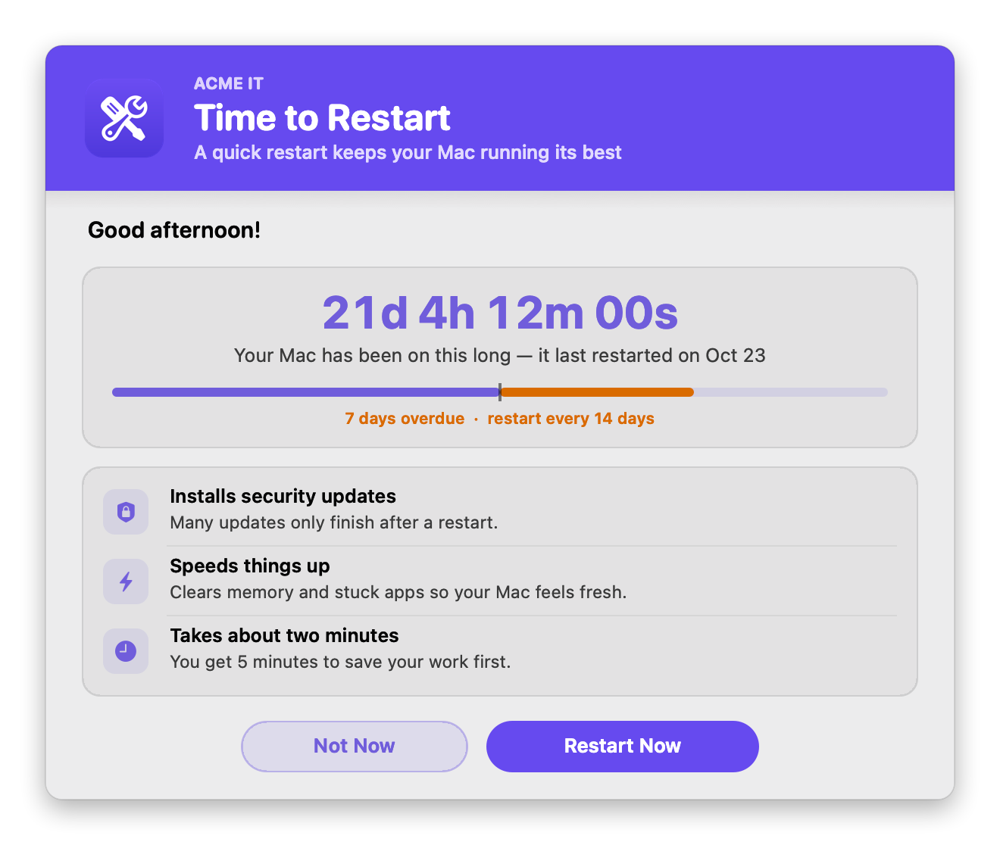
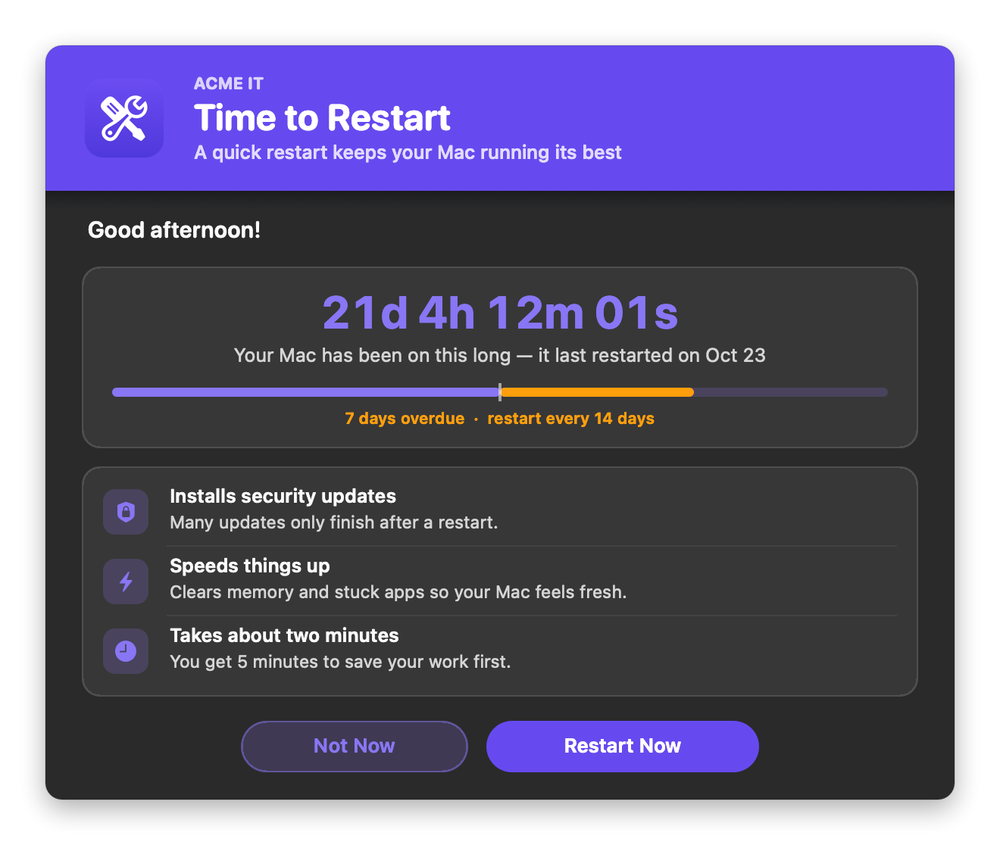
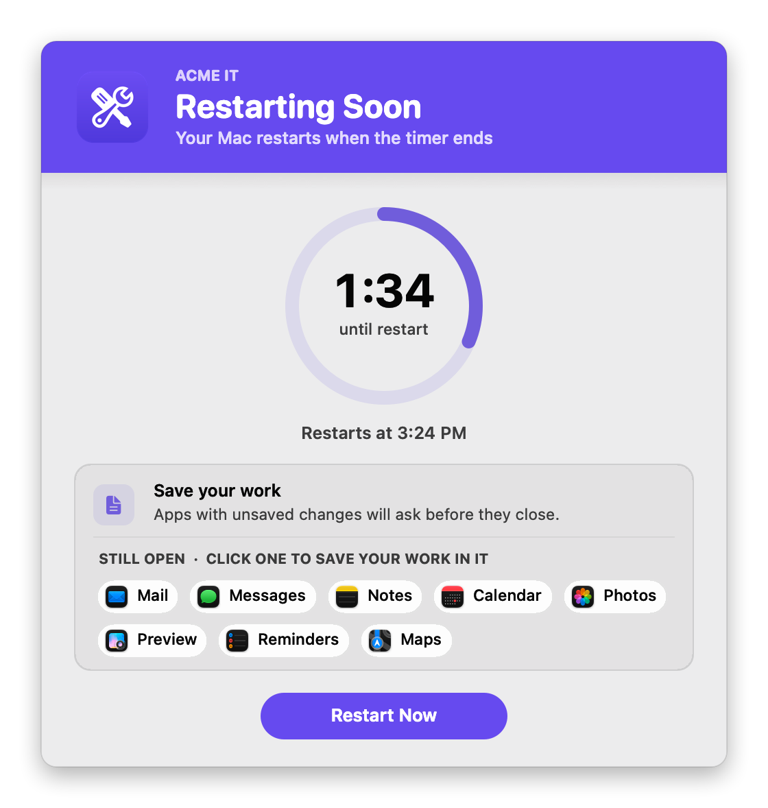
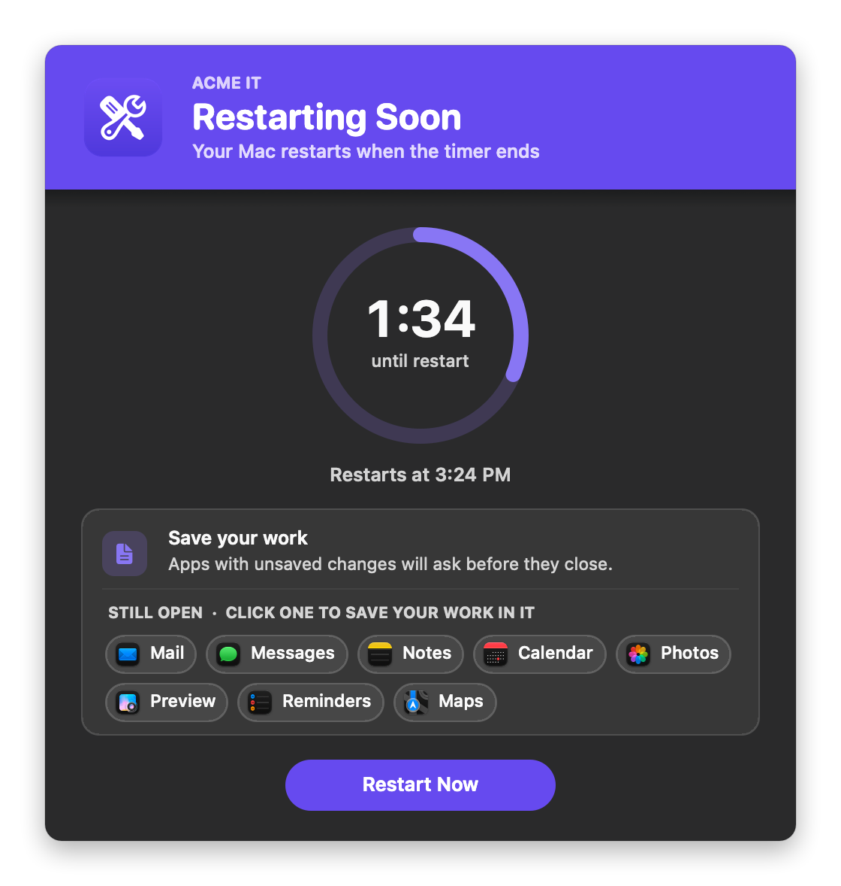

# Recommend User Reboot

Reminds the user to restart their Mac once it has been up longer than a set number of days. The reminder shows how long it's been (live, to the second), how overdue it is, and why restarting helps. If they choose **Restart Now**, a countdown gives them time to save their work, and shows which apps are still open. It never interrupts a call or presentation.

It's fully native: the windows are built with `osascript` (JXA) and AppKit, so there's **no swiftDialog or JamfHelper**, and it works when Jamf runs it as root.

### Features:
- **Live uptime**: a big counter that ticks every second ("21d 4h 12m 00s"), with the date of the last restart.
- **How overdue it is**: a bar toward your goal (default 14 days). Past the goal, it turns orange with "7 days overdue · restart every 14 days".
- **Why it matters**: three short reasons (security updates, speed, and how quickly it's done), not a wall of text.
- **A countdown that helps people save**:
  - a ring counting down (default **2 minutes**) with the time it will restart ("Restarts at 3:24 PM")
  - a live list of the apps that are still open, updated the moment one quits or opens; click an app to bring it to the front and save your work in it
  - "Everything's closed — you're ready to restart" once nothing is left open
- **A normal restart**: it asks macOS to restart the way the Apple menu does, so apps can still ask to save unsaved work.
- **Respects meetings**: no reminder while an app keeps the display awake (Zoom, Teams, Webex, FaceTime, presenting, full-screen video). The log says which app it skipped for.
- **Optional postpone limit**: allow a set number of "Not Now"s ("You can postpone 2 more times"), then only Restart Now. The count resets after each restart.
- **Branding**: your logo, team name and colors, in light and dark mode.

## Screens

**Reminder**: a Mac that's a week past the 14-day goal.
<br />
 

**Countdown**: with the apps that are still open (click one to save your work in it).
<br />
 

## Available Scripts

### 1. [Recommend User Reboot](https://github.com/cocopuff2u/MacOS_Admin_Scripts/blob/main/Recommend_User_Reboot/Recommend_User_Reboot.sh)
- **No dependencies**: uses only built-in macOS tools.

## Jamf Setup

On the script's **Options** tab in Jamf Pro, add these parameter labels:

| Parameter | Label | Value |
|---|---|---|
| 4 | Uptime days before reminding (blank = 14) | Remind once the Mac has been up at least this many days. `0` = always remind. |
| 5 | Countdown minutes before restart (blank = 2) | Minutes to save work after **Restart Now**. |
| 6 | Action Mode (verbose or dry) | Blank = normal. `dry` = show the windows but never restart, and skip the uptime and meeting checks so the reminder always appears. |
| 7 | Brand Icon (optional) | See [Branding](#branding) |
| 8 | Banner Color (hex, optional) | e.g. `#1F2937`, `auto`, or `auto-dark` |
| 9 | Brand Name (optional) | e.g. `Acme IT` |

Example policies:

| Policy | Parameter 4 | Trigger / Frequency |
|---|---|---|
| Remind after two weeks | `14` | Recurring Check-in, once a day |
| "Restart My Mac" in Self Service | `0` | Self Service, Ongoing |
| Test a new policy | `14`, with Parameter 6 = `dry` | Self Service, Ongoing |

**Upgrading from 2.0:** 2.0 defaulted to a dry run when Parameter 6 was blank, so it never restarted unless it was set to `false`. In 3.0, blank means a normal run. `dry` still means a dry run.

## How it decides

1. **No one logged in?** Nothing to do.
2. **Up fewer than Parameter 4 days?** Nothing to do.
3. **In a meeting or presenting?** An app is keeping the display awake (except `IGNORE_ASSERTION_APPS`, such as Amphetamine). It skips this time and tries again at the next run.
4. **Otherwise** it shows the reminder. **Not Now** ends it until the next run; **Restart Now** starts the countdown.

When the countdown ends (or they click Restart Now again), the Mac restarts the normal way. If macOS can't be asked to restart, it falls back to `shutdown -r now` when running as root.

## Branding

Set the logo with Parameter 7 or `BRAND_ICON`:

| Value | Example | Notes |
|---|---|---|
| Image file | `/Library/Application Support/Acme/logo.png` | png, jpg, heic, icns, pdf, tiff, gif |
| App or folder | `/Applications/Self Service.app` | Uses its Finder icon |
| URL | `https://acme.com/logo.png` | Downloaded each run |
| Base64 | `iVBORw0KGgo…` | Make it with `base64 -i logo.png \| pbcopy` |
| SF Symbol | `sf:arrow.clockwise.circle.fill` | Tinted to match the theme |
| Self Service | `selfservice` (or `ss`) | Your Jamf Self Service branding logo, falling back to the Self Service app's icon |

### Colors

Each color setting takes a hex value or `auto`:

| Setting | `auto` behavior |
|---|---|
| `bannerColor` | The logo's exact main color. `auto-dark` uses a deeper shade so white text reads. With no logo, `#0056D2`. |
| `BANNER_TEXT_COLOR` | White, or near-black if the banner is too light for white to read |
| `ACCENT_COLOR` | The banner color, made readable on the window. Used for the counter, ring, icons and buttons. |

## Configuration

At the top of the script:

| Setting | Default | What it does |
|---|---|---|
| `UPTIME_DAYS` | `14` | Remind once up this many days (Parameter 4). `0` = always |
| `RESTART_MINUTES` | `2` | Countdown minutes (Parameter 5) |
| `MAX_DEFERRALS` | `0` | How many times **Not Now** is allowed before only **Restart Now** is offered. `0` = no limit. Resets after each restart |
| `SKIP_DURING_MEETINGS` | `true` | Don't remind while an app keeps the display awake |
| `IGNORE_ASSERTION_APPS` | `Amphetamine,caffeinate` | Apps that keep the display awake but aren't meetings |
| `DRY_RUN_OVERRIDE` | `false` | `true` never restarts. Keep `false` for production |
| `STATE_FILE` | `/Library/Application Support/RecommendUserReboot/state.plist` | Remembers the postpone count |
| `logFile` | `/var/log/recommend_user_reboot.log` | The script's own run log |
| `BRAND_ICON`, `BRAND_NAME`, `APPEARANCE`, colors | | See [Branding](#branding) |
| `REMIND_TITLE`, `COUNTDOWN_TITLE`, button labels… | | Window text |

## Testing

```bash
./Recommend_User_Reboot.sh 14 1 dry                     # the windows, with a 1-minute countdown; never restarts
./Recommend_User_Reboot.sh 14 1 dry "sf:arrow.clockwise.circle.fill" "#1F6FEB" "Acme IT"
sudo ./Recommend_User_Reboot.sh 0                       # the real thing, always reminds
```

## Notes

- Requires macOS 12 or later.
- Always exits `0` (not due, postponed, skipped for a meeting, restarting, or dry run).
- Uptime comes from the kernel's boot time (`kern.boottime`), so sleep doesn't reset it, but a restart does.
