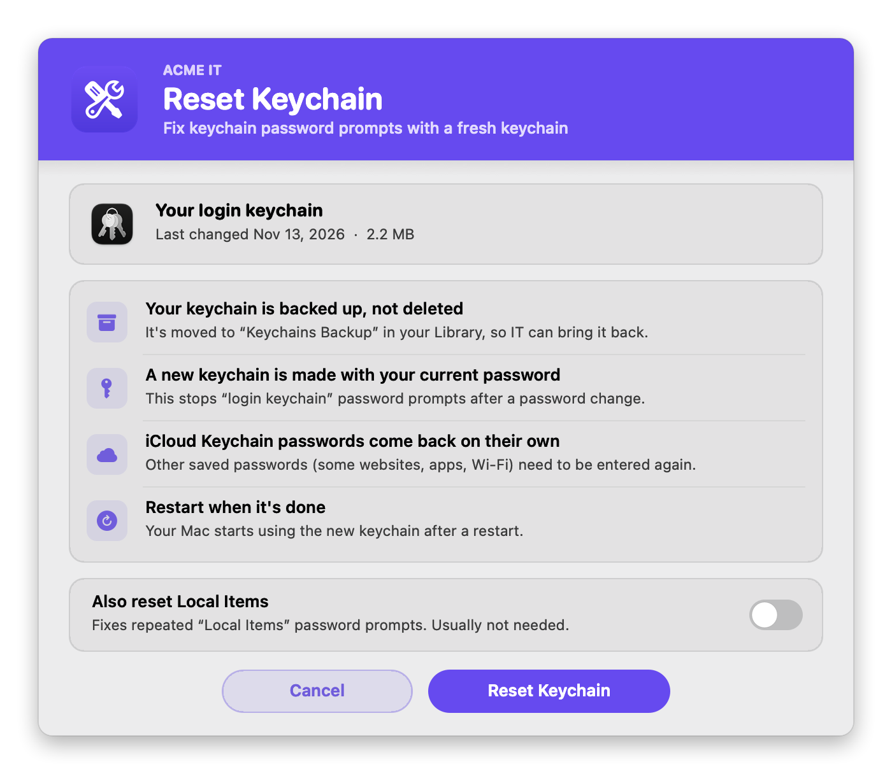
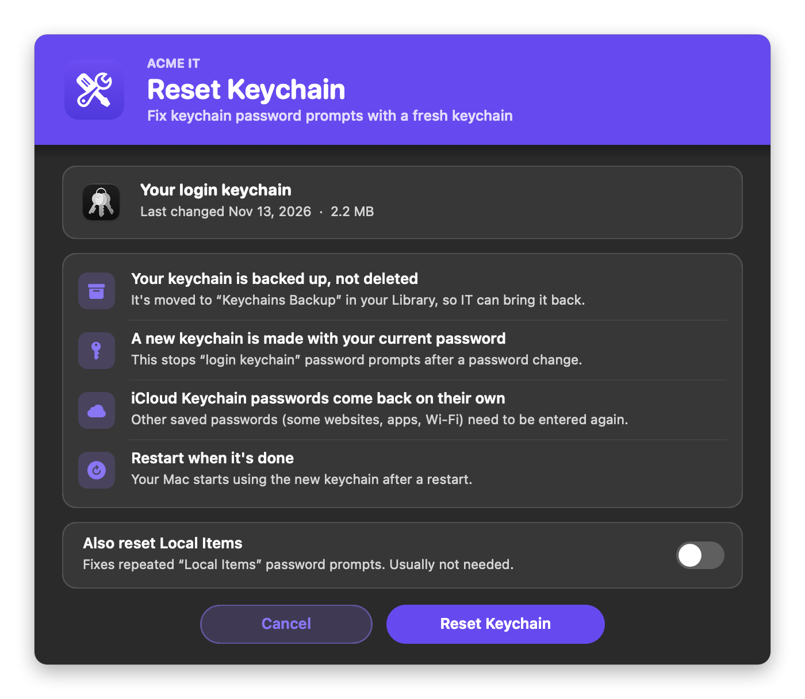
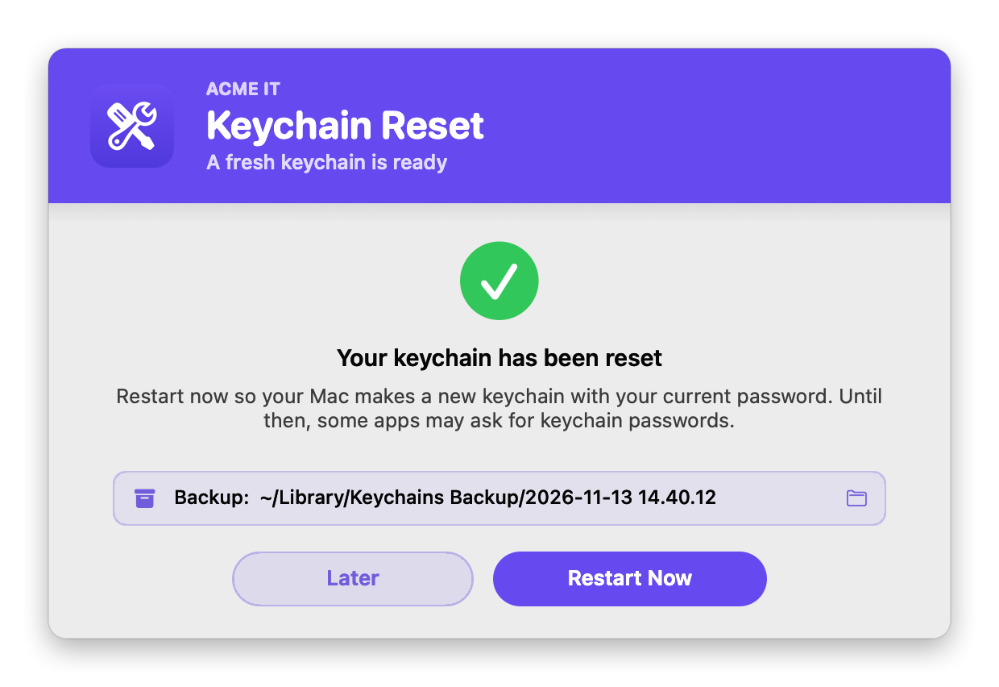
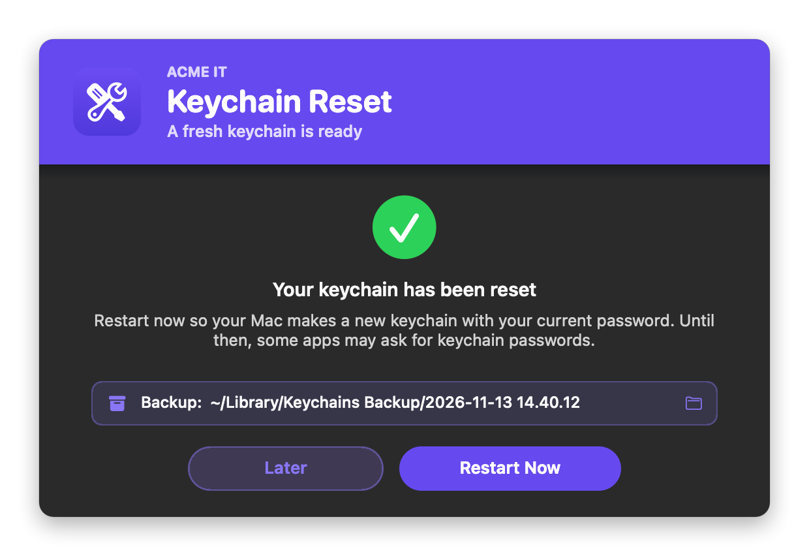

# Reset User Keychain

Gives the logged-in user a fresh login keychain. It fixes the "login keychain" password prompts that keep coming back after a password change (the old keychain still uses the old password) and, optionally, the repeated "Local Items" prompts.

**Nothing is deleted.** The current keychain is moved to a dated backup folder in the user's Library, so it can be put back. After a restart, macOS makes a new login keychain with the user's current password.

It's fully native: the windows are built with `osascript` (JXA) and AppKit, so there's **no swiftDialog or JamfHelper**, and it works when Jamf runs it as root.

### Features:
- **Explains what will happen**: in four plain steps. The keychain is backed up, not deleted. A new keychain is made with the current password. iCloud Keychain passwords come back on their own (others need to be entered again). A restart is needed.
- **Shows the keychain**: when it last changed and how big it is.
- **Backed up, never deleted**: the files are moved to `~/Library/Keychains Backup/<date and time>/`, which only the user (and root) can open. Each reset gets its own folder, with a `README.txt` on how to put it back.
- **Login keychain only, by default**: the Local Items keychain (the folder named with the Mac's hardware ID, which holds the iCloud Keychain data) is only reset when the user turns on **Also reset Local Items**, or you set Parameter 5.
- **Finishes the job**: the last window shows where the backup is (click it to open it in Finder) and offers **Restart Now** or **Later**. Restart Now restarts the way the Apple menu does, so apps can still ask to save work.
- **Branding**: your logo, team name and colors, in light and dark mode.
- **Three modes**: `verbose` (the user confirms), `dry` (the same windows, nothing changed), and `silent` (no windows).

## Screens

**Confirm:**
<br />
 

**Done**: where the backup is, and Restart Now or Later.
<br />
 

## Available Scripts

### 1. [Reset User Keychain](https://github.com/cocopuff2u/MacOS_Admin_Scripts/blob/main/Reset_User_Keychain/Reset_User_Keychain.sh)
- **No dependencies**: uses only built-in macOS tools.

## Jamf Setup

On the script's **Options** tab in Jamf Pro, add these parameter labels:

| Parameter | Label | Value |
|---|---|---|
| 4 | Action Mode (verbose, dry, or silent) | `verbose` (default): the user confirms. `dry`: the same windows, nothing changed. `silent`: no windows; resets right away (the user still needs to restart). |
| 5 | Also reset Local Items (yes or no) | `yes` also resets the Local Items keychain. In the window it's the switch's starting position, which the user can change. Blank = `RESET_LOCAL_ITEMS` (`false`). |
| 6 | Brand Icon (optional) | See [Branding](#branding) |
| 7 | Banner Color (hex, optional) | e.g. `#1F2937`, `auto`, or `auto-dark` |
| 8 | Brand Name (optional) | e.g. `Acme IT` |
| 9 | Appearance (auto, light, or dark) | `auto` follows the user's setting |

Example policies:

| Policy | Parameter 4 | Parameter 5 | Frequency |
|---|---|---|---|
| "Reset Keychain" in Self Service | *(blank)* | *(blank)* | Ongoing |
| Test a new policy | `dry` | *(blank)* | Ongoing |
| Help desk reset, no windows (tell the user to restart) | `silent` | *(blank)* | Ongoing |

## The backup

Each reset moves the files (never copies or deletes them) into a new folder:

```
~/Library/Keychains Backup/2026-11-13 14.40.12/
    login.keychain-db                       ← the login keychain
    metadata.keychain-db                    ← if it exists
    364C3979-1739-52AA-AA7F-9D76D35C1EA0/   ← Local Items, only when that was chosen
    README.txt                              ← how to put it back
```

The folder belongs to the user and only they (and root) can open it (`700`), because a keychain holds saved passwords. To put a backup back: log out (or restart and don't log in as that user), then move the files back into `~/Library/Keychains/`, replacing the new ones. A restored keychain still uses the password it had when it was backed up.

The run log (`/var/log/reset_user_keychain.log`) lists every file that was moved and where it went.

## Branding

Set the logo with Parameter 6 or `BRAND_ICON`:

| Value | Example | Notes |
|---|---|---|
| Image file | `/Library/Application Support/Acme/logo.png` | png, jpg, heic, icns, pdf, tiff, gif |
| App or folder | `/Applications/Self Service.app` | Uses its Finder icon |
| URL | `https://acme.com/logo.png` | Downloaded each run |
| Base64 | `iVBORw0KGgo…` | Make it with `base64 -i logo.png \| pbcopy` |
| SF Symbol | `sf:key.fill` | Tinted to match the theme |
| Self Service | `selfservice` (or `ss`) | Your Jamf Self Service branding logo, falling back to the Self Service app's icon |

### Colors

Each color setting takes a hex value or `auto`:

| Setting | `auto` behavior |
|---|---|
| `bannerColor` | The logo's exact main color. `auto-dark` uses a deeper shade so white text reads. With no logo, `#0056D2`. |
| `BANNER_TEXT_COLOR` | White, or near-black if the banner is too light for white to read |
| `ACCENT_COLOR` | The banner color, made readable on the window. Used for the icons, switch and buttons. |
| `SUCCESS_COLOR`, `FAIL_COLOR` | Apple-style light and dark values |

## Configuration

At the top of the script:

| Setting | Default | What it does |
|---|---|---|
| `RESET_LOCAL_ITEMS` | `false` | Also reset the Local Items keychain (Parameter 5 overrides; in the window it's the switch's starting position) |
| `DRY_RUN_OVERRIDE` | `false` | `true` always previews. Keep `false` for production |
| `BACKUP_FOLDER_NAME` | `Keychains Backup` | The backup folder in the user's `~/Library` |
| `logFile` | `/var/log/reset_user_keychain.log` | The script's own run log |
| `BRAND_ICON` | blank | Logo (Parameter 6) |
| `BRAND_NAME` | `IT Support` | Small line above the title, e.g. `Acme IT` (Parameter 8). Blank = none |
| `APPEARANCE` | `auto` | `auto`, `light` or `dark` (Parameter 9) |
| Colors | `auto` | See [Colors](#colors) |
| `CONFIRM_TITLE`, `DONE_TITLE`, button labels… | | Window text |

## Testing

```bash
./Reset_User_Keychain.sh dry                        # the windows, nothing changed
./Reset_User_Keychain.sh dry yes "sf:key.fill" "#1F6FEB" "Acme IT" dark
sudo ./Reset_User_Keychain.sh                       # the real thing, as Jamf runs it
```

A real reset changes the user's keychain and needs a restart, so test it on a spare Mac or a test account.

## Notes

- Requires macOS 12 or later.
- Exit codes: `0` = reset, dry run, cancelled or nothing to reset. `1` = no logged-in user, or the keychain couldn't be backed up and reset (Jamf marks the policy as failed). If any file can't be moved, nothing is deleted.
- Version 1.x deleted everything in `~/Library/Keychains` with no backup. 2.0 only moves files, and only the login keychain unless Local Items is chosen.
