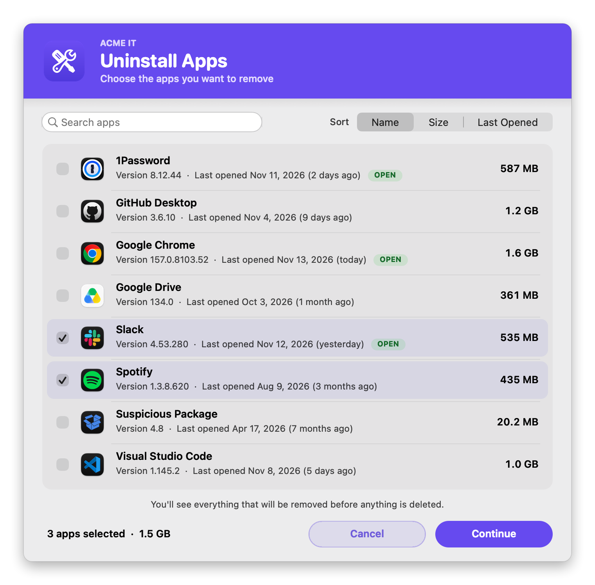
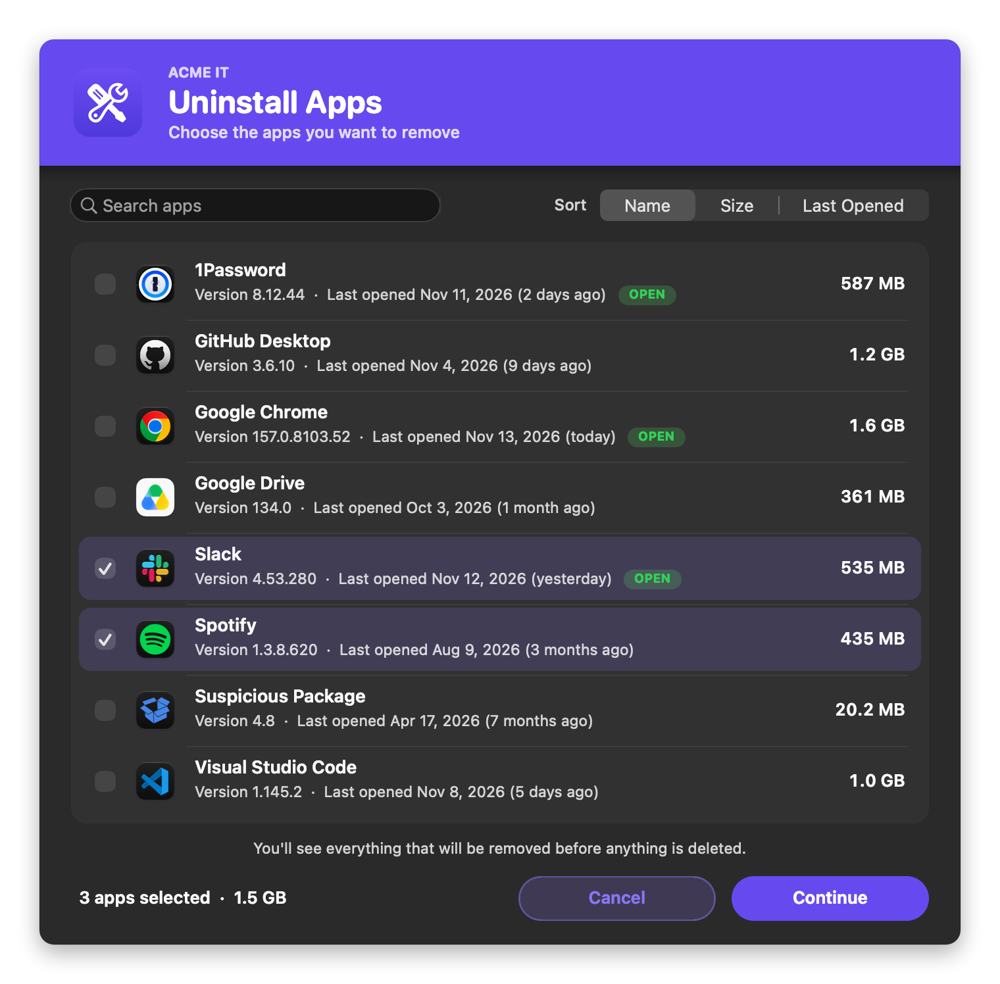
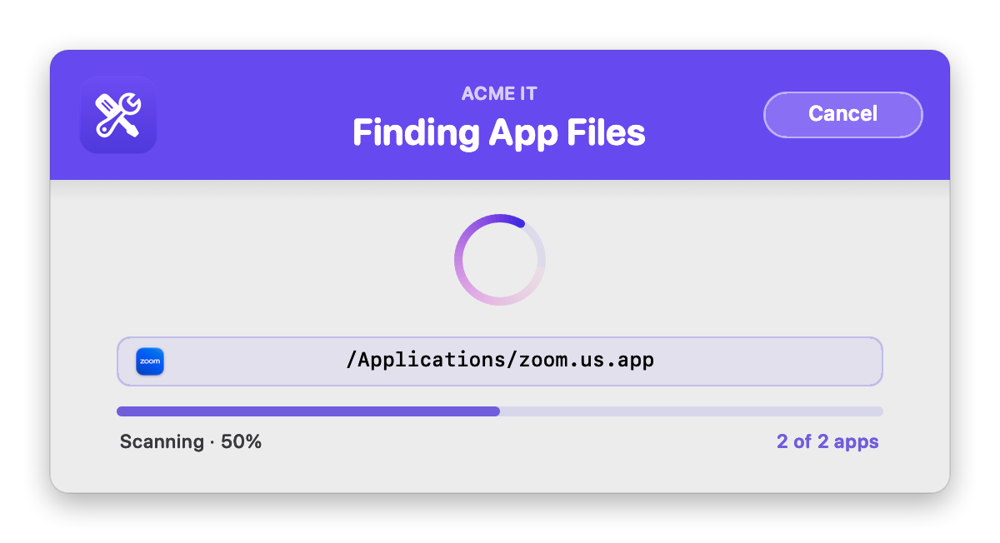
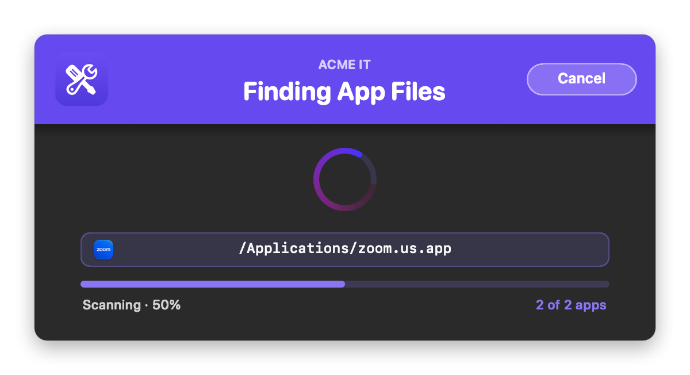
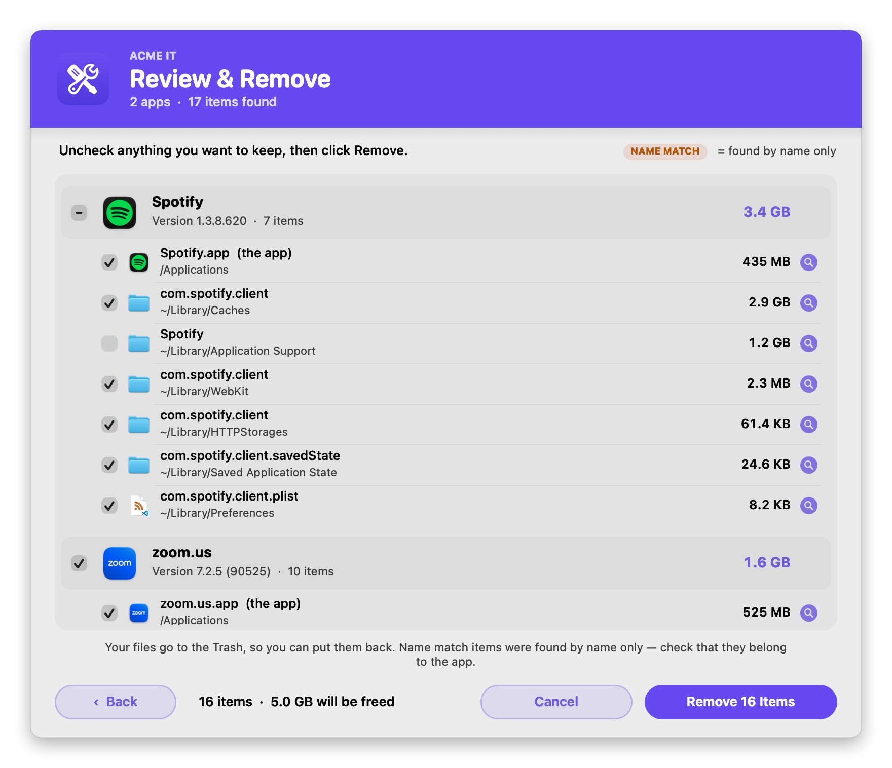
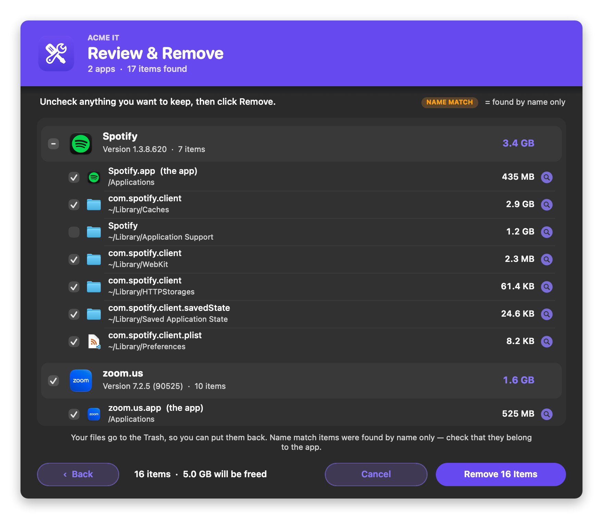
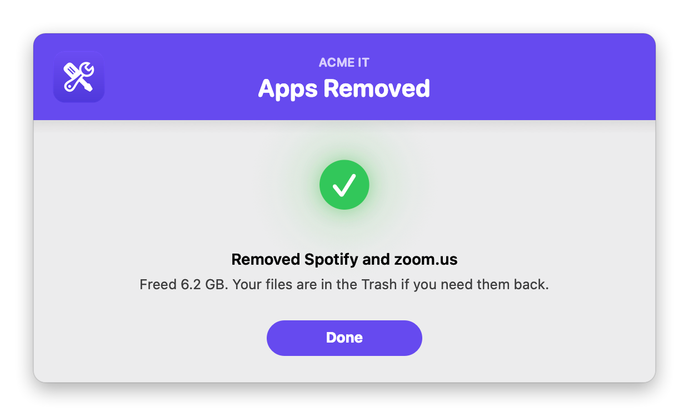
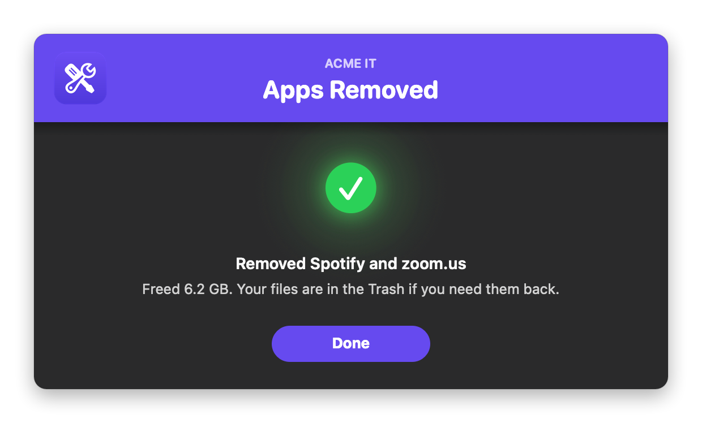

# Self Service App Uninstaller

Completely removes one or more Mac apps **and** the leftover files they scatter around the system: preferences, caches, containers, login items, support files and installer receipts, the way the "AppCleaner" utility does. Dragging an app to the Trash leaves those files behind, often gigabytes of them. This finds everything tied to each app and removes it in one step.

It's built for **Jamf Self Service**. The user picks the apps (or you name them in the policy) and sees every file that will be removed, with its size. They uncheck anything they want to keep, then confirm. **Nothing is removed without the user seeing it first.**

It's fully native, with **no swiftDialog, JamfHelper or other dependencies**. The interface is built with `osascript` (JXA) and AppKit and shows in the logged-in user's session, so it works when Jamf runs it as root. It has the same branded look as [Collect User Logs](https://github.com/cocopuff2u/MacOS_Admin_Scripts/blob/main/Collect_User_Logs), [Network Health Check](https://github.com/cocopuff2u/MacOS_Admin_Scripts/blob/main/Network_Health_Check) and [Disk Usage](https://github.com/cocopuff2u/MacOS_Admin_Scripts/blob/main/Disk_Usage).

### Features:
- **Pick several apps at once**: a list of installed apps with checkboxes, icons, version, size, when each was last opened, and an **OPEN** badge on apps that are running. **Search** by name, and sort by **Name**, **Size** or **Last Opened** (apps you haven't used in the longest time first). A running total shows how many apps are picked and how much space they take.
- **Complete removal**: for each app it reads the bundle id, Team ID and name, then checks about 40 `~/Library` and `/Library` locations, launch agents and daemons, privileged helpers, and `pkgutil` installer receipts.
- **Review before anything happens**: every app and its files are grouped, each with a checkbox, Finder icon, location and size. Each app has a checkbox of its own that ticks or clears all of its files, and shows a dash when only some are checked. A magnifying-glass button shows any item in Finder. The total to be freed and the **Remove N Items** button update as boxes are ticked.
- **Name match tags**: files found only because their name contains the app's name as a whole word are tagged **NAME MATCH**, so the user can check them. Files that clearly belong to the app (its bundle id, Team ID, or a folder named exactly like the app) aren't tagged.
- **Progress and Cancel**: a progress window shows each app being scanned (with its icon) and then each item being removed. Cancel or Esc stops the scan; nothing has been removed at that point.
- **Quits the app first**: running apps are asked to quit, and force-quit after 10 seconds if they don't. Their launch agents and daemons are unloaded before removal.
- **Recoverable**: the user's files and the app itself go to the user's **Trash**. System files in `/Library` and receipts are deleted. Every item and where it went is logged.
- **Summary**: says which apps were removed and how much space was freed, or how many items couldn't be removed.
- **Protected apps**: Apple's apps and a configurable list of management tools (Jamf Connect, Jamf Protect, Self Service, Nudge, Setup Manager and so on) are hidden from the picker and refused if a policy names them.
- **Dry run**: shows the whole experience, but nothing is removed. Use it to test a policy.
- **Silent mode**: removes the named apps fleet-wide with no windows.
- **Branding**: your logo, brand name and colors. The colors can come **automatically from your logo**, including your Jamf Self Service branding image.
- **Light and dark mode**: follows the user's setting, or you can force one.

## Screens

Shown with the sample logo ([`images/sample_logo.png`](images/sample_logo.png), a generic placeholder you can use for testing), the brand name "Acme IT", and sample data. Light mode is on the left, dark mode on the right.

**Pick apps**: check one or more. Search, and sort by name, size or last opened. (Skipped when the policy names the apps.)
<br />
 

**Finding each app's files**:
<br />
 

**Review and remove**: uncheck anything to keep. The total updates as you go.
<br />
 

**Done**:
<br />
 

## Available Scripts

### 1. [Self Service App Uninstaller](https://github.com/cocopuff2u/MacOS_Admin_Scripts/blob/main/Self_Service_App_Uninstaller/Self_Service_App_Uninstaller.sh)
- **Description**: Fully uninstalls one or more Mac apps and their leftover files. Deploy it as a Self Service policy: the user picks the apps, reviews a checklist and confirms before anything is removed.

## Jamf Setup

1. Go to **Settings > Computer Management > Scripts > New** and paste in the script.
2. In the **Options** tab, set the Parameter Labels:
   - **Parameter 4:** `Apps to remove (name, bundle id or path; comma-separated; blank = user picks)`
   - **Parameter 5:** `Action Mode (verbose, dry, or silent)`
   - **Parameter 6:** `Brand Icon (path, .app, URL, base64, sf:symbol, or selfservice — optional)`
   - **Parameter 7:** `Banner Color (hex, optional)`
   - **Parameter 8:** `Brand Name (optional)`
   - **Parameter 9:** `Appearance (auto, light, or dark)`
3. Add the script to a **Policy** and fill in the parameters. Every one is optional.
   - **Parameter 4**: blank shows the app picker. Or name one or more apps, comma-separated, and the user goes straight to the review. Each can be a name (`Slack`), a bundle id (`com.tinyspeck.slackmacgap`) or a path (`/Applications/Slack.app`), e.g. `Slack, zoom.us, Spotify`.
   - **Parameter 5**: blank or `verbose` for the normal windows. `dry` shows the same windows but removes nothing. `silent` shows no windows and removes the apps in Parameter 4 (see [Silent mode](#silent-mode)).
   - **Parameter 6**: your logo. See [Branding](#branding). `selfservice` uses your Jamf Self Service branding image.
   - **Parameter 7**: a hex color like `#1F2937`, or `auto` (match the logo) or `auto-dark` (a deeper shade of the logo color, for white text).
   - **Parameter 8**: a small uppercase line above the title, e.g. `Acme IT`. Blank = `BRAND_NAME` in the script (`IT Support`).
   - **Parameter 9**: `auto` follows the user's Light/Dark setting; `light` or `dark` forces one.
4. Set the trigger to **Self Service**. A user must be logged in for the windows to appear.

**Example policies:**

| Policy | Parameter 4 | Parameter 5 |
|---|---|---|
| "Uninstall Apps" in Self Service: the user picks | *(blank)* | *(blank)* |
| "Remove Zoom" in Self Service | `zoom.us` | *(blank)* |
| Test a new policy | `Slack` | `dry` |
| Remove an app from every Mac, no windows | `Spotify` | `silent` |

## How it finds an app's files

For each app it looks inside about 40 folders in `~/Library` and `/Library`: Application Support, Caches, Containers, Group Containers, Preferences, Saved Application State, HTTPStorages, WebKit, Logs, LaunchAgents, Internet Plug-Ins and more. It also checks `/Library/LaunchDaemons`, `/Library/PrivilegedHelperTools` and the installer receipts in `/private/var/db/receipts`. Only items directly inside those folders are matched; it never goes looking across the whole disk.

| What matched | Example for Slack | Tagged | Starts |
|---|---|---|---|
| The app itself | `/Applications/Slack.app` | | checked |
| Its bundle id | `~/Library/Caches/com.tinyspeck.slackmacgap` | | checked |
| Its Team ID + bundle id | `~/Library/Group Containers/TEAMID.com.tinyspeck.slackmacgap` | | checked |
| Named exactly like the app | `~/Library/Application Support/Slack` | | checked |
| Name contains the app's name as a whole word | `~/Library/Logs/Slack Helper` | **NAME MATCH** | checked (`NAME_MATCHES_CHECKED`) |
| A file from the app's installer package whose path names the app | `/Library/Audio/Plug-Ins/Components/Slack…` | **NAME MATCH** | checked (`NAME_MATCHES_CHECKED`) |

Names shorter than 4 characters (`MIN_NAME_LEN`) skip the loose name match, so an app called "Box" doesn't match every folder with "box" in it. Name matches are whole words only, so "Code" matches `Code Helper` but not `onetimepasscodes` or `Xcode`, and Apple's own `com.apple.*` files are never matched by name. If one item sits inside another, only the outer one is listed.

When the app is removed, its installer receipts are forgotten (`pkgutil --forget`), so the Mac no longer reports the package as installed.

## Silent mode

With Parameter 5 set to `silent`, there are no windows. It removes the apps named in Parameter 4 and the files that **clearly** belong to them: the app, and its bundle id, Team ID and exact-name matches. **NAME MATCH** items are left alone unless you set `SILENT_NAME_MATCHES=true`. Everything is listed in the policy log. Silent mode needs Parameter 4; with it blank, the script stops without removing anything and the policy fails.

## Branding

Set `BRAND_ICON` (or Parameter 6) to any **one** of these:

| Value | Example | Notes |
|---|---|---|
| Image file | `/Library/Application Support/Acme/logo.png` | png, jpg, heic, icns, pdf, tiff, gif |
| App or folder | `/Applications/Self Service.app` | Uses its Finder icon |
| URL | `https://acme.com/logo.png` | Downloaded each run |
| Base64 | `iVBORw0KGgo…` | Make it with `base64 -i logo.png \| pbcopy`. Over about 1 MB is too long for a Jamf parameter: paste it into the script, or shrink it first with `sips -Z 256 logo.png`. |
| SF Symbol | `sf:trash.fill` | Tinted to match the theme |
| Self Service | `selfservice` (or `ss`) | Your Jamf Self Service branding logo, as saved on the Mac for the logged-in user. If they haven't opened Self Service yet, it falls back to the Self Service app's icon. |

If the logo is missing or can't be read, a warning goes in the log and the windows show without it.

### Colors

Every color setting accepts `"auto"` (the default) or a hex value (`#RRGGBB` or `#RGB`) to force it. An invalid hex value is treated as `auto`. They work the same way as in [Collect User Logs](https://github.com/cocopuff2u/MacOS_Admin_Scripts/blob/main/Collect_User_Logs#colors-automatic-or-forced):

| Setting | `auto` behavior |
|---|---|
| `bannerColor` | The logo's exact main color. `auto-dark` uses a deeper shade so white text reads. With no logo, `#0056D2`. |
| `BANNER_TEXT_COLOR` | White, or near-black if the banner is too light for white to read |
| `ACCENT_COLOR` | The banner color, made readable on the window. Used for checkboxes, sizes, the spinner, progress bar and buttons. |
| `SPINNER_BG_COLOR`, `SUCCESS_COLOR`, `FAIL_COLOR` | Apple-style light and dark values |

## Configuration

All settings are at the top of the script.

| Setting | Default | What it does |
|---|---|---|
| `TARGET_APPS` | blank | Hardcode the app(s) for a dedicated per-app policy, e.g. `"Slack"`. Blank = Parameter 4 |
| `DRY_RUN_OVERRIDE` | `false` | `true` always previews, whatever Parameter 5 says. Keep `false` for production |
| `NAME_MATCHES_CHECKED` | `true` | `false` starts NAME MATCH items unchecked, so the user opts in to each |
| `SILENT_NAME_MATCHES` | `false` | Silent mode also removes NAME MATCH items |
| `MIN_NAME_LEN` | `4` | App names shorter than this skip the loose name match |
| `FORGET_RECEIPTS` | `true` | Forget the app's installer receipts after it's removed |
| `INCLUDE_USER_APPS` | `true` | The picker also lists apps in `~/Applications` |
| `PICKER_ROWS_SHOWN` | `8` | Rows visible at once in the picker (it scrolls for more) |
| `logFile` | `/var/log/app_uninstaller.log` | The script's own run log |
| `PROTECTED_BUNDLE_IDS` | Jamf Connect, Self Service, Self Service+, Jamf Protect, Setup Manager, Nudge, CrowdStrike Falcon, Microsoft Defender, SentinelOne, Sophos, Company Portal | Never removed: the id or any sub-id under it |
| `PROTECTED_APP_NAMES` | `Jamf Connect`, `Jamf Protect`, `JamfProtect`, `Nudge`, `Setup Manager` | Never removed: exact name |
| `PROTECTED_NAME_SUBSTRINGS` | `Self Service` | Never removed: anything whose name contains it |
| `BRAND_ICON` | blank | Logo (Parameter 6) |
| `BRAND_NAME` | `IT Support` | Small line above the title, e.g. your team name `Acme IT` (Parameter 8). Blank = none |
| `APPEARANCE` | `auto` | `auto`, `light` or `dark` (Parameter 9) |
| Colors | `auto` | See [Colors](#colors) |
| `PICKER_TITLE`, `REVIEW_TITLE`, `DONE_TITLE`, `REVIEW_NOTE`, button labels… | | Window text. `removeButton` uses `{N}` for the count |

> Add your security, VPN and EDR tools to the `PROTECTED_*` lists so they can never be removed from Self Service.

## Testing

Nothing is removed with `dry`:

```bash
./Self_Service_App_Uninstaller.sh "" dry                   # pick apps, review: preview only
./Self_Service_App_Uninstaller.sh "Slack, Spotify" dry     # straight to the review
./Self_Service_App_Uninstaller.sh "" dry "sf:trash.fill" "#1F6FEB" "Acme IT" dark
sudo ./Self_Service_App_Uninstaller.sh                     # the real thing, as Jamf runs it
```

## Notes

- **Run as root for system files.** Run locally as a normal user, files in `/Library` (launch daemons, helpers, receipts) can't be removed; they're counted as failures and logged. Jamf runs it as root. Some app containers are protected by macOS privacy controls, so give the Jamf binary Full Disk Access with a PPPC profile, as most Jamf setups already do.
- **Exit codes:** `0` means removed, dry run, cancelled or nothing to do. `1` means an app couldn't be found or is protected, or an item couldn't be removed. Jamf shows `1` as a failed policy.
- **Trash:** items in the Trash can be restored by dragging them back out, but Finder's "Put Back" isn't available. That's because they're moved there directly, not through Finder, which a root process can't script.
- **Requirements:** macOS 12 or later. Uses only built-in tools: `mdls`, `codesign`, `pkgutil`, `du`, `osascript`.

## Questions, Concerns, and Requests

We value your feedback and encourage you to engage with us. Here’s how you can get involved:

- **Report Issues**: [Submit an issue on GitHub](https://github.com/cocopuff2u/MacOS_Admin_Scripts/issues) to report bugs or request new features.
- **Join the Discussion**: Connect with me, cocopuff2u, on the [Mac Admins Slack Channel](https://join.slack.com/t/macadmins/shared_invite/zt-2o5811yhx-q5MNLrFG1VoHRusXLgZwsw) to discuss improvements and collaborate with other Mac administrators.
- **Email**: Contact me directly at [cocopuff2u@yahoo.com](mailto:cocopuff2u@yahoo.com) for any specific inquiries or detailed discussions.
- **Share Feedback**: Your input is invaluable! Share your thoughts and suggestions to help us enhance these scripts.
- **Fork and Fix**: Interested in contributing? Fork the repository, make your changes, and submit a pull request to improve the codebase.
