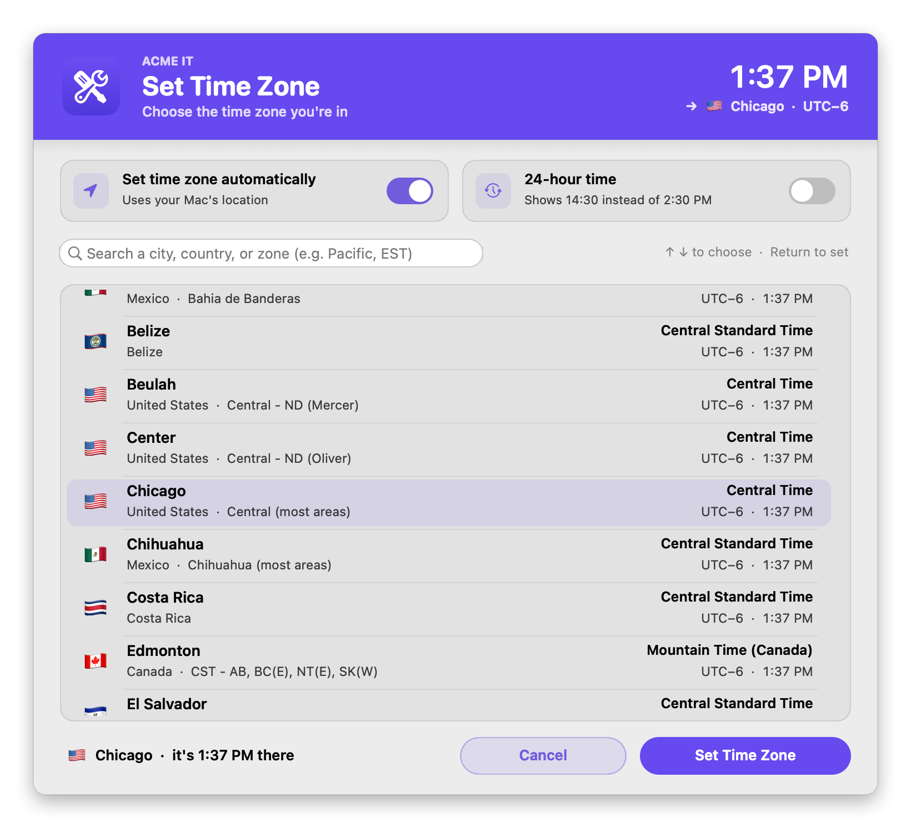
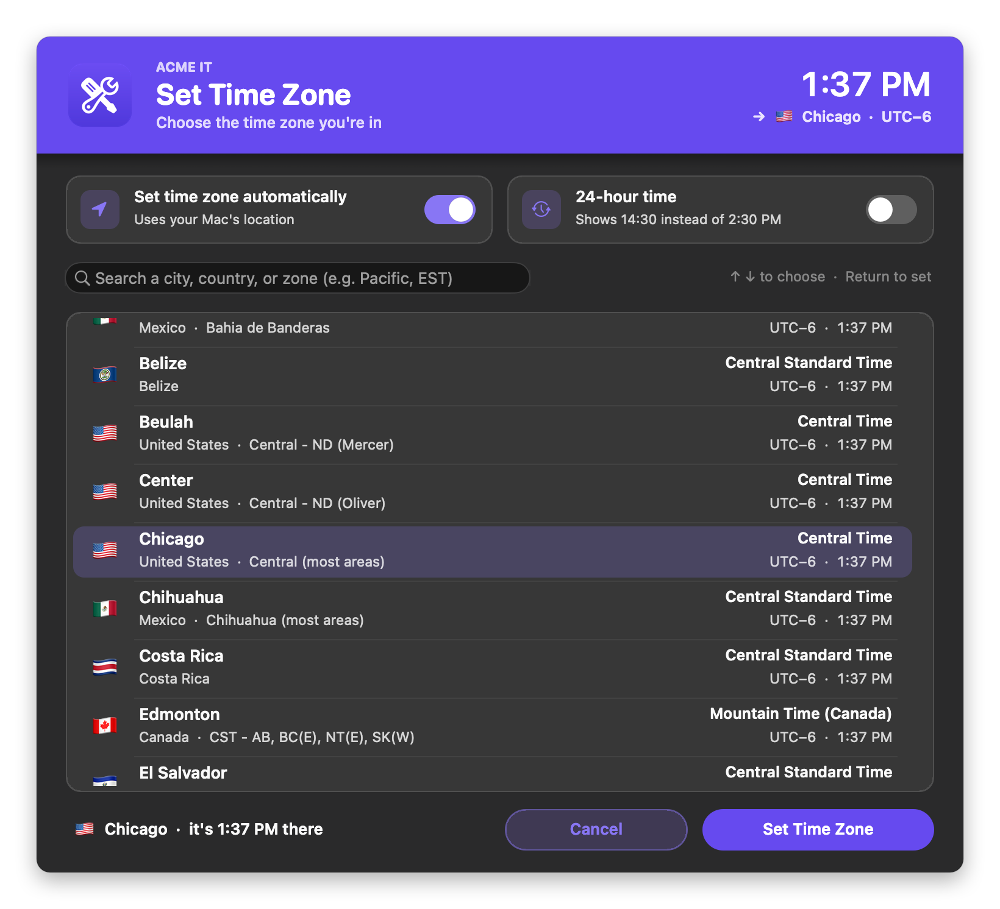
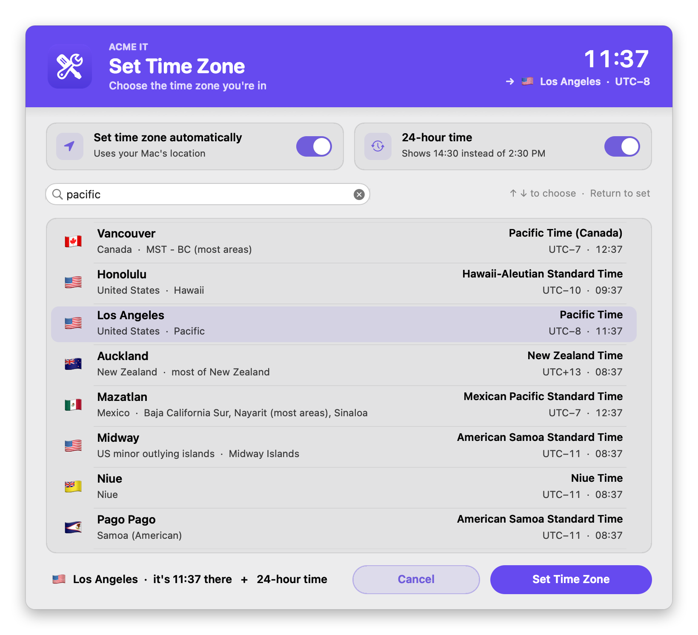
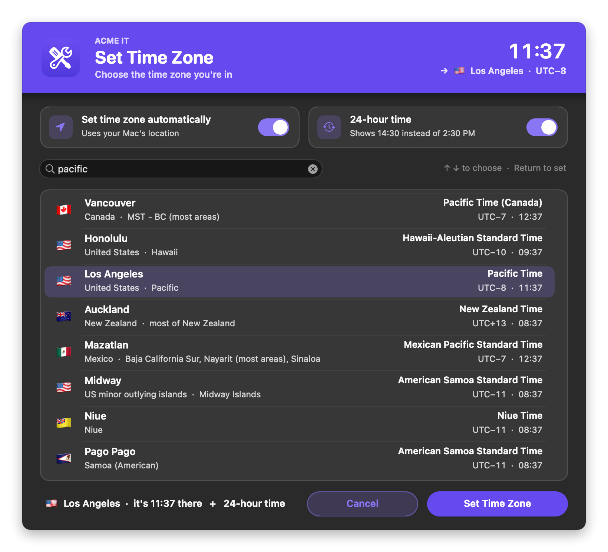
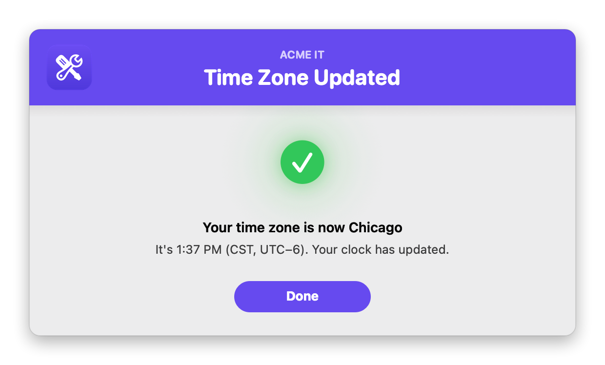
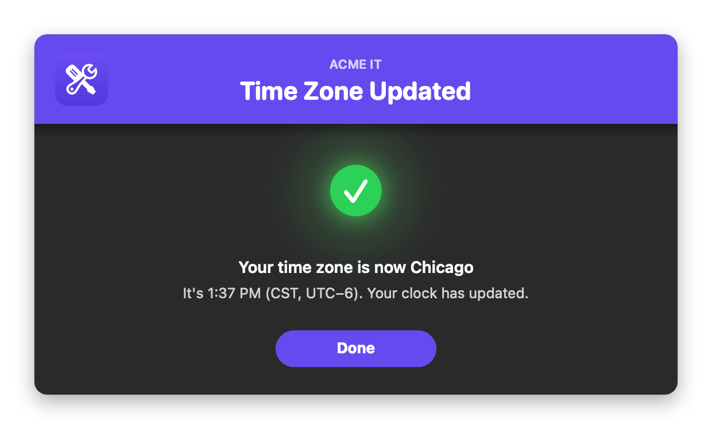

# Set Time Zone

Lets the user set their Mac's time zone from a searchable list of every time zone, turn **automatic time zone** on or off, and switch to a **24-hour clock**, all from one branded window. You can also set a zone for them from the policy, with no window at all.

It's fully native: the window is built with `osascript` (JXA) and AppKit, so there's **no swiftDialog or JamfHelper**, and it works when Jamf runs it as root.

### Features:
- **Every time zone, readable**: each row shows the flag, city, country and region, the zone's name ("Central Time"), its UTC offset, and the time there now. The list opens on the user's current zone, tagged **CURRENT**.
- **Search that finds things the way people look**:
  - cities, countries and regions
  - zone names ("Central Standard Time", "Pacific") and abbreviations (CST, PT, EST)
  - UTC offsets typed any way (`utc-6`, `GMT+9`, `-06:00`, `utc+5:30`)
  - big cities that share a zone (Beijing, Mumbai, San Francisco, Boston, Dallas, Frankfurt…)
  - old names (Calcutta, Saigon), US states (California, Texas) and nicknames (UK, USA, UAE)
  - the best match comes first
- **Keyboard**: type to search, ↑ / ↓ to choose, Return to set. Double-clicking a zone sets it too.
- **Preview in the title bar**: the clock in the corner shows the time in the zone you've picked, so the user sees exactly what their clock will show.
- **Set time zone automatically**: a switch, like in System Settings. It can be on **together with** a zone picked by hand, so a wired Mac gets the right zone now and still updates when it can find its location. If automatic can't work (Wi-Fi or Location Services is off), the switch says so.
- **24-hour time**: a second switch. Every time in the window changes as soon as it's flipped, and the menu bar clock updates right away when it's applied.
- **A picked zone sticks**: setting a zone by hand turns off automatic time zone unless the user leaves it on, so macOS doesn't switch it back.
- **Branding**: your logo, team name and colors, in light and dark mode.
- **Three modes**: `verbose` (the window), `dry` (the same window, nothing changed), and `silent` (no window; sets the zone in Parameter 4).

## Screens

**Choose a zone**: the clock in the corner previews the time there.
<br />
 

**Search** ("pacific"), with 24-hour time switched on:
<br />
 

**Done:**
<br />
 

## Available Scripts

### 1. [Set Time Zone](https://github.com/cocopuff2u/MacOS_Admin_Scripts/blob/main/Set_Time_Zone/Set_Time_Zone.sh)
- **No dependencies**: uses only built-in macOS tools (`systemsetup`, `defaults`, `osascript`) and macOS's own time zone data.

## Jamf Setup

On the script's **Options** tab in Jamf Pro, add these parameter labels:

| Parameter | Label | Value |
|---|---|---|
| 4 | Time Zone (blank = the user picks) | Blank: the user picks. Or a zone as macOS names it, e.g. `America/Chicago`, `Europe/London`, `UTC` (see `sudo systemsetup -listtimezones`), or `auto` to turn on automatic time zone. |
| 5 | Action Mode (verbose, dry, or silent) | `verbose` (default): the window. `dry`: the same window, nothing changed. `silent`: no window; sets the zone in Parameter 4. |
| 6 | Brand Icon (optional) | See [Branding](#branding) |
| 7 | Banner Color (hex, optional) | e.g. `#1F2937`, `auto`, or `auto-dark` |
| 8 | Brand Name (optional) | e.g. `Acme IT` |
| 9 | Appearance (auto, light, or dark) | `auto` follows the user's setting |

Example policies:

| Policy | Parameter 4 | Parameter 5 |
|---|---|---|
| "Set Time Zone" in Self Service | *(blank)* | *(blank)* |
| Set Chicago for a building or department, and show the user | `America/Chicago` | *(blank)* |
| Set Chicago quietly (no window) | `America/Chicago` | `silent` |
| Turn on automatic time zone | `auto` | `silent` |
| Test a new policy | *(blank)* | `dry` |

A zone set from the policy turns automatic time zone off, so it sticks.

## Automatic time zone

macOS finds the time zone from the Mac's location, and a Mac finds its location by scanning nearby **Wi-Fi** networks (it has no GPS). So automatic time zone needs:

- **Location Services** on, with **Setting time zone** allowed (System Settings → Privacy & Security → Location Services → System Services).
- **Wi-Fi turned on**. It doesn't have to be joined to a network, but with the Wi-Fi radio off (common on wired desktops) there's nothing to find the location from.

The window shows when either is missing, and the result says so instead of claiming success. For wired desks, set the zone from a policy scoped by Building, Department, or network segment, or let users pick a zone and leave automatic on so it takes over whenever it can.

Turning automatic on or off sets both switches macOS uses (the System Settings toggle and `timed`'s own setting) and restarts `timed` so it notices. Writing the setting alone isn't enough.

## Branding

Set the logo with Parameter 6 or `BRAND_ICON`:

| Value | Example | Notes |
|---|---|---|
| Image file | `/Library/Application Support/Acme/logo.png` | png, jpg, heic, icns, pdf, tiff, gif |
| App or folder | `/Applications/Self Service.app` | Uses its Finder icon |
| URL | `https://acme.com/logo.png` | Downloaded each run |
| Base64 | `iVBORw0KGgo…` | Make it with `base64 -i logo.png \| pbcopy` |
| SF Symbol | `sf:clock.fill` | Tinted to match the theme |
| Self Service | `selfservice` (or `ss`) | Your Jamf Self Service branding logo, falling back to the Self Service app's icon |

### Colors

Each color setting takes a hex value or `auto`:

| Setting | `auto` behavior |
|---|---|
| `bannerColor` | The logo's exact main color. `auto-dark` uses a deeper shade so white text reads. With no logo, `#0056D2`. |
| `BANNER_TEXT_COLOR` | White, or near-black if the banner is too light for white to read |
| `ACCENT_COLOR` | The banner color, made readable on the window. Used for the selection, switches and buttons. |
| `SUCCESS_COLOR`, `FAIL_COLOR` | Apple-style light and dark values |

## Configuration

At the top of the script:

| Setting | Default | What it does |
|---|---|---|
| `TARGET_ZONE` | blank | Hardcode a zone (or `auto`) for a dedicated policy. Blank = Parameter 4 |
| `DRY_RUN_OVERRIDE` | `false` | `true` always previews. Keep `false` for production |
| `TURN_OFF_AUTO_TIMEZONE` | `true` | Turn off automatic time zone when a zone is set by hand (unless the user leaves the switch on), so macOS doesn't switch it back |
| `PICKER_ROWS_SHOWN` | `8` | Rows visible at once in the list |
| `logFile` | `/var/log/set_time_zone.log` | The script's own run log |
| `BRAND_ICON` | blank | Logo (Parameter 6) |
| `BRAND_NAME` | `IT Support` | Small line above the title, e.g. `Acme IT` (Parameter 8). Blank = none |
| `APPEARANCE` | `auto` | `auto`, `light` or `dark` (Parameter 9) |
| Colors | `auto` | See [Colors](#colors) |
| `PICKER_TITLE`, `PICKER_SUBTITLE`, `DONE_TITLE`, button labels… | | Window text |

## Testing

```bash
./Set_Time_Zone.sh "" dry                                   # the window, nothing changed
./Set_Time_Zone.sh "" dry "sf:clock.fill" "#1F6FEB" "Acme IT" dark
sudo ./Set_Time_Zone.sh                                     # the real thing, as Jamf runs it
sudo ./Set_Time_Zone.sh America/Chicago silent              # set a zone, no window
```

Changing the time zone or automatic time zone needs root. The 24-hour clock is the user's own setting and doesn't.

## Notes

- Requires macOS 12 or later.
- Exit codes: `0` = set, dry run, cancelled or already set. `1` = the zone in Parameter 4 isn't valid, or something couldn't be changed (Jamf marks the policy as failed).
- The 24-hour clock is a per-user setting (`AppleICUForce24HourTime`), the same one System Settings → General → Date & Time changes.
